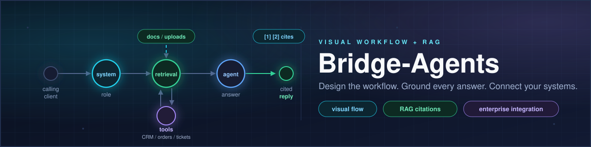
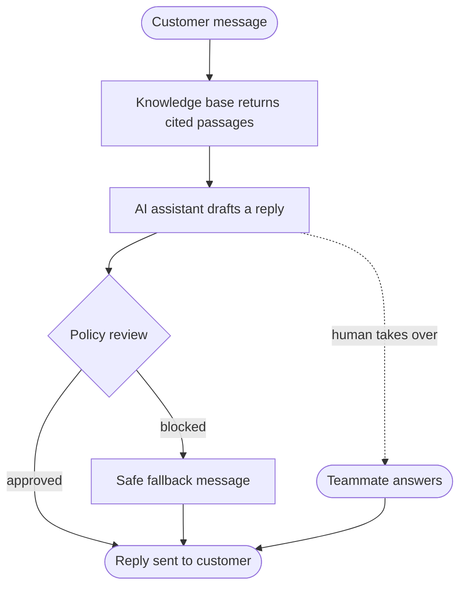

<div align="center">



# Bridge-Agents

**AI support that never sends a reply you cannot stand behind.**

<sub>Self-hosted, review-gated agent runtime for customer conversations — orchestrate the flow, gate the output, hand off to humans.<br />The bridge between mature enterprise systems and AI support agents.</sub>


<sub><a href="README.zh-CN.md">简体中文</a> · English</sub>

<br /><br />

[Why Bridge-Agents](#why-bridge-agents) · [How it works](#how-it-works) · [Demo](#the-30-second-demo) · [Quick start](#quick-start) · [Deploy](#deploying) · [Packages](#packages-and-embedding) · [Where it fits](#where-it-fits) · [FAQ](#faq) · [Roadmap](#roadmap)

</div>

## The problem

AI support is fast, cheap and one bad sentence away from a refund, a compliance
review or a screenshot on social media. Most tools hand you a bot and hope for
the best. Bridge-Agents is built around a different question: **who checks the
reply before the customer sees it?**

## Why Bridge-Agents

| 🛡 **Review before send** | 🙋 **Humans stay in control** |
|---|---|
| A second model reviews every draft against your policy. Approved text streams to the customer; a rejected draft is replaced by your fallback and never shown. | A teammate can take over a conversation and the AI's pending answer is cancelled — then reply from the support desk or the bound Lark chat. The customer gets a person, not a duplicate reply. |
| 📚 **Answers with sources** | 🧩 **Change the flow, not the code** |
| Every reply is grounded in your documentation. The retriever finds relevant passages, the assistant cites them as [1], [2], and the review gate still checks the wording. | The conversation flow is saved configuration. Operators rewire it on a drag-and-drop canvas; a flow that cannot run is refused before it goes live. A JSON editor remains for advanced edits. |

Also in the box:

- **Provider moderation:** the local banned-word hard gate plus optional OpenAI,
  Azure AI Content Safety, Google Perspective, Alibaba Cloud and Tencent Cloud
  checks, with fail-open / fail-closed policy and per-provider text chunking.
- **Mainstream model providers:** OpenAI, Azure OpenAI (native client), DeepSeek,
  Qwen, Kimi, Zhipu GLM, Doubao, ERNIE, MiniMax, SiliconFlow, OpenRouter, Gemini,
  Anthropic gateways, Ollama and any OpenAI-compatible endpoint.
- **A demo customers can actually use:** nickname entry (no sign-in), parallel
  conversations in a sidebar, image attachments, streaming replies, bilingual
  UI, light/dark themes and phone layouts.
- **A support desk built for clarity:** AI and human replies are labelled
  differently, takeover state is visible per conversation, and images render in
  the transcript.

Plus the boring-but-important part: **your data stays yours.** Self-hosted,
SQLite by default (PostgreSQL/MySQL extras), no external calls in demo mode, and
roles for customers, support staff and admins. The runtime is also a pip package
with an embeddable async API.

## How it works



1. The retriever finds relevant passages in your knowledge base and the
   assistant drafts an answer that cites them.
2. Before a word reaches the customer, a reviewer checks the draft against your
   policy — the text is buffered while this happens.
3. Approved replies stream naturally. Rejected replies become a safe,
   pre-written fallback. When a conversation needs a human, a teammate takes
   over and the AI stops.

The flow is a graph of nodes (`system`, `retrieval`, `agent`, `tools`, `custom`,
`sanitize`, `review`, start/end) that you can edit visually or as JSON; see
[docs/architecture.md](docs/architecture.md) for the full contract.

## The 30-second demo

> **Demo GIF slot: [`docs/screenshots/demo.gif`](docs/screenshots/README.md).**
> The walkthrough is recorded from the real UI at release time, never from a
> mock-up.

1. A customer enters a nickname, then asks *"How do I activate Widget Pro?"* —
   the answer cites the knowledge base passage as [1].
2. They open a second conversation from the sidebar and ask *"Can you guarantee
   a refund?"* — the draft promises a refund, the review gate blocks it, and the
   customer sees a policy-safe fallback instead.
3. A teammate takes over from the support desk, the AI stops writing, and the
   human answers directly. The transcript marks AI replies and human replies
   separately.

## Quick start

### One command (local, no Docker)

Requirements: Python 3.11, [uv](https://github.com/astral-sh/uv), and Node.js
only for the first web build.

```bash
git clone <repository-url> bridge-agents
cd Bridge-Agents
uv sync
uv run bridge-agents demo
```

The first run copies `.env.example` to `.env`, builds the web UI when needed and
starts the deterministic mock model plus the API. One process serves both the UI
and the API:

- **http://localhost:8000/** — customer entry
- **http://localhost:8000/admin** — support desk; Studio under `/admin/studio`
- **http://localhost:8000/health** — health check

Useful details:

- `uv run bridge-agents doctor` checks the local prerequisites (Python, Node, `.env`,
  web build, ports).
- `bridge-agents demo --port 18000 --mock-port 8002` moves the ports;
  `--no-build` skips the web build.
- `make demo` is the same command; `make help` lists the other targets.

### One command (Docker)

```bash
docker compose up --build
```

This starts the API, the web GUI and a deterministic mock model, so everything
runs offline with no API key:

- **http://localhost/** — customer entry
- **http://localhost/admin** — staff portal
- **http://localhost:8000/health** — API health

Conversations live on a named volume, so `docker compose restart api` keeps your
data. Set `WEB_PORT` / `API_PORT` when the default ports are taken.

### Manual development (API + Vite hot reload)

```bash
uv sync
cp .env.example .env          # set ALLOW_DEV_LOGIN=true for the demo login
uv run bridge-agents init-db
uv run bridge-agents serve --reload        # API + built UI on :8000
```

For front-end hot reload run the Vite dev server in a second terminal; it proxies
`/api` and `/ws` to the API:

```bash
npm --prefix web install
npm --prefix web run dev                   # http://localhost:5173
```

## Configuration

Non-secret settings can live in `bridge-agents.toml` (see
[bridge-agents.toml.example](bridge-agents.toml.example)); secrets stay in `.env`
or the environment. Precedence:

**CLI arguments > environment variables > `.env` > `bridge-agents.toml` > defaults**

Point the app at a file with `--config PATH` or `BRIDGE_CONFIG`. Generate a
starter pair with `bridge-agents init` and validate it with
`bridge-agents config check`.

Common switches:

| Variable | Default | What it changes |
|---|---|---|
| `APP_ENV` | `development` | `production` disables the demo login and tightens defaults |
| `BRIDGE_CONFIG` | `bridge-agents.toml` | optional non-secret config file |
| `DATABASE_URL` | local SQLite file | switch to PostgreSQL or MySQL |
| `AUTH_VERIFIER` / `JWT_*` | HS256 | local secret, RS256 PEM key or external OIDC JWKS |
| `ALLOW_DEV_LOGIN` | `false` | demo login; forced off in production |
| `LLM_PROVIDER` / `OPENAI_*` | `openai` / mock model | provider preset, endpoint, model, key, timeout |
| `MODERATION_*` | disabled | provider moderation keys, ranges and host allow-list |
| `RAG_*` | hash embedder | retrieval chunking, top-k, embeddings endpoint |
| `WEB_DIST_DIR` | `web/dist` | built GUI served by the API; empty disables static serving |
| `LARK_*` | disabled | signed Lark webhook and support commands |

Every setting is documented in [.env.example](.env.example) and
[docs/architecture.md](docs/architecture.md#configuration).

The web GUI calls `GET /api/v1/meta` for the server version, `api_version` and
`min_web_version`, so a separately deployed GUI can detect a version mismatch.

## Deploying

The Python packages and the GUI ship separately, so the GUI can be hosted by
nginx/CDN while the server stays a plain pip install:

| Artifact | Contents |
|---|---|
| `bridge-agents` | core Python runtime (no server dependencies) |
| `bridge-agents-server` | FastAPI server, database models, CLI; pins the matching core version |
| `bridge-agents-web-<version>.tar.gz` | built static GUI for nginx/CDN (never inside the wheel) |

```bash
python -m venv /opt/bridge-agents/.venv
/opt/bridge-agents/.venv/bin/pip install "bridge-agents-server[postgres]"

bridge-agents init --config /etc/bridge-agents/bridge-agents.toml \
    --env-file /etc/bridge-agents/bridge-agents.env
bridge-agents init-db --config /etc/bridge-agents/bridge-agents.toml
bridge-agents config check --config /etc/bridge-agents/bridge-agents.toml
bridge-agents serve --config /etc/bridge-agents/bridge-agents.toml
```

The standard topology is **nginx serving the static GUI and proxying `/api` and
`/ws` to the server on `127.0.0.1:8000`** — same origin, no CORS needed.
Copy [deploy/bridge-agents.service](deploy/bridge-agents.service) and
[deploy/nginx.conf](deploy/nginx.conf), and follow
[deploy/README.md](deploy/README.md) for the production checklist.

Build all release artifacts from a checkout with `make release` (two wheels plus
the versioned web archive).

## Packages and embedding

This repository builds two Python distributions plus the web artifact:

- **`bridge-agents`** (import `bridge_agents`) — review-gated pipeline, graph
  validation, retrieval, auth verifiers, moderation adapters, injection guard,
  rate limiter, embeddable `AgentRuntime` and testing fakes.
- **`bridge-agents-server`** — the FastAPI app, database models and the
  `bridge-agents` CLI. Extras: `[postgres]`, `[mysql]`.
- **Web UI** — React/Vite in `web/`, built into `web/dist` and released as a
  static archive.

Neither distribution is published on PyPI yet; build or install from a checkout:

```bash
uv build                                                   # both wheels in dist/
pip install --find-links dist bridge-agents                # core library only
pip install --find-links dist "bridge-agents-server[postgres]"
uv sync                                                    # app + CLI in the local venv
uv run bridge-agents version
```

Embed the runtime without the HTTP stack:

```python
from bridge_agents.runtime import AgentRuntime

async with AgentRuntime(llm=my_chat_model) as runtime:
    answer = await runtime.reply("How do I activate Widget Pro?")
    async for event in runtime.stream("Can I get a refund?"):
        ...
```

Mount the server in an existing FastAPI service if you already own the HTTP
layer:

```python
from app.main import create_app

app.mount("/bridge-agents", create_app())
```

`bridge_agents.testing` ships deterministic `FakeChatModel` / `FakeModerator`
doubles so tests need no network or API key. The library README is at
[packages/bridge_agents/README.md](packages/bridge_agents/README.md).

## Development

Requirements: Python 3.11, [uv](https://github.com/astral-sh/uv) and Node 20+ for
the web UI.

```bash
make demo        # mock model + API + built UI on :8000
make test        # pytest (312 offline tests)
make lint        # ruff check + format check
make check       # lint + tests + web build
make release     # wheels + static GUI release archive
make help        # all targets
```

Backend layout: `app/` (FastAPI, models, services, CLI), `packages/bridge_agents/`
(core library), `web/` (React UI), `tests/`, `deploy/`, `docs/`. Quality gates:
pytest (91% combined coverage of `app/core` and the library), ruff, a repository
sanitisation gate and CI for lint, tests, secrets and the web build.

Start here:

- [docs/architecture.md](docs/architecture.md) — API, runtime nodes, configuration, quality gates
- [docs/design-decisions.md](docs/design-decisions.md) — why the product works this way
- [deploy/README.md](deploy/README.md) — production topology and checklist
- [CHANGELOG.md](CHANGELOG.md) — what changed recently

## Where it fits

| | Bridge-Agents | Typical low-code bot builders |
|---|---|---|
| Built around reviewing the reply, not just generating it | ✅ review gate inside the runtime | moderation usually happens after generation |
| Human handoff that stops the AI mid-answer | ✅ takeover cancels the pending reply | depends on the product |
| The conversation flow lives with your code and review | ✅ saved configuration, validated before activation | usually edited in a hosted canvas |
| Answers grounded in your documentation | ✅ hybrid retrieval with citations and an editable knowledge base | often prompt-only or a separate add-on |
| Change the model or support prompt without a deploy | ✅ Studio settings, applied to the next message | usually an environment change and restart |
| Self-hosted and embeddable | ✅ pip packages for the runtime/server, static GUI, one-command demo | often a closed SaaS platform |

Low-code platforms are great for drag-and-drop prototyping. Bridge-Agents is for
teams whose replies carry commercial or legal weight — where "the bot said it"
is not an acceptable answer.

## Status

**0.1.0 is in progress.** What is real today vs. what is next:

| Now | Next |
|---|---|
| Review-gated runtime: buffering, retries, fallbacks, safe defaults | Database migrations (Alembic) and an upgrade command |
| Provider moderation: local hard gate + 5 providers, chunking, fail policy | Browser OIDC login flow (JWKS/RS256 token verification already exists) |
| Model provider presets: OpenAI, Azure OpenAI and 13 more (OpenAI-compatible vendors + custom gateway) | PyPI publishing and container images (server + web) with release automation |
| RAG with citations, upload, reindex and search preview | Slack adapter and a public webhook API |
| Visual flow editor with node inspector, auto layout and JSON fallback | Embeddable customer widget, reranking and multi-tenant storage |
| Support desk with takeover, AI/human labels and image transcript | Kubernetes/Helm deployment option |
| Customer demo: nickname entry, conversation history, attachments, streaming | — |
| Bilingual, responsive UI with light/dark themes | — |
| Lark channel with signed webhook and two-way human replies | — |
| Packaging: two pip distributions, TOML/env config, CLI, static web release, systemd/nginx templates | — |
| Offline one-command demo and Docker Compose stack | — |
| 312 offline tests, 91% coverage, ruff and sanitisation gates | — |

## FAQ

**Is this a chatbot builder?**
No. It is the runtime *behind* a chat product: the part that decides what the AI
may say, who can change the flow, and when a human steps in.

**Do I need an API key to try it?**
No. The default mode uses a deterministic mock model, so a fresh checkout works
offline.

**Do I need Docker?**
No. `uv sync && uv run bridge-agents demo` runs the whole demo locally. Docker
Compose is an alternative that also runs offline.

**Is there a login screen in the demo?**
No. Customers enter a nickname (used for addressing and to keep each browser's
conversations separate) and start chatting. The internal demo login is for
development only and is disabled in production.

**Where are the two entry points?**
`/` is the customer chat with no staff navigation. `/admin` is the staff portal:
the support desk at `/admin`, Studio (flow, knowledge, settings) at
`/admin/studio`.

**Which models and moderation vendors are supported?**
Model presets cover OpenAI, Azure OpenAI (native client), DeepSeek, Qwen, Kimi,
Zhipu GLM, Doubao, ERNIE, MiniMax, SiliconFlow, OpenRouter, Gemini, Anthropic
gateways, Ollama and any OpenAI-compatible endpoint. Moderation supports the
local banned-word list plus OpenAI-compatible, Azure, Perspective, Alibaba Cloud
and Tencent Cloud adapters.

**Can I change the model or the support prompt without redeploying?**
Yes. Studio → Settings changes provider/model/sampling/API key and the
customer-support system prompt. Saving applies to the next message; the API key
is stored encrypted and is never returned by the API.

**Can a human reply to the customer?**
Yes. The support desk shows a live transcript; take over the conversation and the
reply box sends a real message the customer receives instantly. A bound Lark
chat works the same way.

**Does it answer from my own documentation?**
Yes. The retriever indexes a knowledge directory (seeded from `docs/kb`, editable
in Studio) and the assistant cites the passages it used. The default embedder is
deterministic and offline; `RAG_EMBEDDER=openai` uses any `/v1/embeddings`
endpoint.

**Can a non-engineer edit the flow?**
Yes. The visual editor saves configuration that is validated before it goes
live; the JSON editor remains for advanced edits.

**Is it production-ready?**
Not yet. 0.1.0 is the first release; see the [status table](#status) and the
[deployment checklist](deploy/README.md) for what a real deployment still needs.

**Does the UI work in Chinese, on a phone, in dark mode?**
Yes. The UI ships in English and 简体中文 with a remembered switch, is responsive
down to 360 px, and supports light/dark themes that apply before first paint.

## Security and privacy

No credentials or customer data are shipped with this repository. The demo login
is never mounted in production, customer and staff roles are separated, provider
keys stay in the environment (or encrypted runtime settings) and every change to
the conversation flow is validated before it can go live. See
[SECURITY.md](SECURITY.md) for vulnerability reporting.

## Roadmap

- [x] Secure access with customer / support / admin roles
- [x] Review-gated runtime with retries, fallbacks and safe defaults
- [x] Admin API to edit, validate and reset the conversation flow
- [x] Real-time conversations: sessions, messages, images and WebSocket streaming
- [x] Browser demo: chat, flow editor and support desk with human takeover
- [x] Human handoff that cancels the in-flight AI reply
- [x] Retrieval-augmented answers: hybrid search, citations, upload and reindex
- [x] Lark channel with signed events and two-way human replies
- [x] Provider moderation for OpenAI, Azure, Perspective, Alibaba Cloud and Tencent Cloud
- [x] Mainstream model provider presets including Azure OpenAI
- [x] Customer demo with nicknames, conversation history and image attachments
- [x] Bilingual, responsive UI with light/dark themes
- [x] Packages, CLI, TOML configuration, static web release and deployment templates
- [x] Offline one-command demo and Docker Compose stack
- [ ] Database migrations (Alembic) and a `db upgrade` command
- [ ] Browser OIDC login flow
- [ ] PyPI publishing, container images and release automation
- [ ] Slack adapter, public webhook API and an embeddable widget
- [ ] Reranking, multi-tenant storage and a Kubernetes/Helm option

## License

Apache-2.0. See [LICENSE](LICENSE).

## Provenance

Bridge-Agents is an independent, sanitized rewrite of a customer-conversation
runtime the author built for an internal production system. It is published
with written permission. No proprietary code, data, credentials, or customer
information is included.
