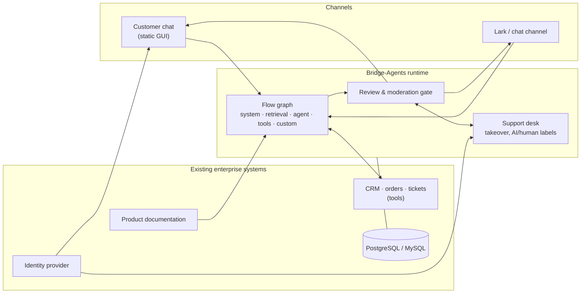
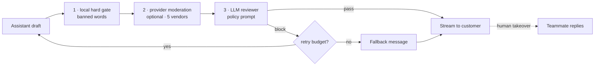

<div align="center">


# Bridge-Agents

**A control plane for AI customer conversations.**

<sub>Operators shape the flow. The runtime reviews every reply before a customer sees it.<br />Your existing enterprise systems stay the source of truth.</sub>


<sub><a href="README.zh-CN.md">简体中文</a> · English</sub>

<br /><br />

[Design](#design-in-one-page) · [Architecture](#architecture) · [Customize](#pillar-1--operators-customize-the-flow) · [Review](#pillar-2--every-reply-passes-review) · [Integrate](#pillar-3--integrate-with-the-enterprise-stack) · [Quick start](#quick-start) · [Deploy](#configuration-and-deployment) · [FAQ](#faq) · [Roadmap](#status-and-roadmap)

</div>

## The problem

Enterprises do not lack AI models. They lack a place to **put AI into a customer
conversation safely**, where three groups of people can work together:

- **Operations staff** need to change what the assistant does — routing,
  knowledge, tone, escalation — without filing a software ticket.
- **Reviewers and support leads** need to know that no reply reaches a customer
  before it has been checked, and need a fast path to take over.
- **IT and platform teams** need the AI to sit next to the systems they already
  run (identity provider, CRM, order system, ticketing, documentation) instead of
  replacing them.

Bridge-Agents is designed around exactly those three requirements. The rest of
this README explains each one and how it is implemented.

## Design in one page

| 🧩 **Operators customize** | 🛡 **The runtime reviews** | 🔌 **It integrates, not replaces** |
|---|---|---|
| The conversation flow is saved data, not code. Business users rewire it on a visual canvas; a flow that cannot compile is rejected before it goes live. Model, prompt, knowledge and moderation settings are forms in the Studio, applied to the next message. | Every customer-visible reply passes layered checks: a deterministic hard gate, optional third-party moderation, an LLM reviewer, and human takeover. Text is buffered until the gate decides; a rejected draft is replaced by a safe fallback and never streamed. | Identity comes from your IdP, answers from your documentation, actions through your system APIs, data in your database, and the GUI is static files behind your nginx. Self-hosted, SQLite by default, no vendor lock-in. |

## Architecture



The product is deliberately split into four planes:

- **Control plane** — the editable graph, prompt, model and moderation settings.
  Owned by operators, validated on save, hot-swapped into the runtime.
- **Data plane** — retrieval, model calls, tools and channel delivery
  ([`packages/bridge_agents`](packages/bridge_agents)).
- **Safety plane** — the review node, banned words, provider moderation and human
  takeover, applied before the customer sees a reply.
- **Integration plane** — identity, tools, knowledge, database and static GUI
  deployment, so the product fits an existing stack.

## Pillar 1 — Operators customize the flow

The starting point is that **a flow is configuration, not a deploy**. Operators
work in the Studio (`/admin/studio`), not in the codebase.

### The flow is a validated graph

A conversation is a graph of nodes; the canvas edits the same JSON configuration
the runtime compiles.

| Node | What an operator uses it for |
|---|---|
| `system` | Set the assistant's role prompt |
| `retrieval` | Ground answers in the knowledge base (top-k, score threshold) |
| `agent` | Generate the customer-facing reply |
| `tools` | Let the agent call registered system tools |
| `custom` | Add an extra model step (translation, classification, rewrite) |
| `sanitize` | Mask banned words and optionally run provider moderation |
| `review` | Gate the reply: accept, retry, fallback or pass through |
| `start` / `end` | Entry and exit |

Operators add nodes from a palette, connect them (including condition handles
such as `respond`, `tool_call`, `pass`, `block`), drag/auto-layout them and edit
fields in a plain-language inspector. Advanced users get a JSON editor for the
same configuration.

**Safety by construction:** the graph is compiled and validated before it is
saved. A broken reference, missing agent role or unroutable edge is rejected —
the previous flow keeps running. Saving hot-swaps the new graph; no redeploy, no
restart.

### Studio covers the rest of the operator job

- **Knowledge** — upload documents, reindex, search-preview the retrieval index;
  point `DOCS_DIR` at an existing documentation folder.
- **Model** — pick a provider preset (OpenAI, Azure OpenAI and 13 more) and an
  endpoint; the available models are fetched from the provider and shown as a
  dropdown (Azure lists deployments). The API key is stored encrypted and never
  returned by the API.
- **Support prompt** — edit the agent's system prompt in the same place.
- **Moderation** — enable provider moderation per sanitize node, choose the
  vendor, fallback text and fail-open/fail-closed policy.
- **Roles and language** — support staff and admins edit; customers only chat.
  The whole Studio and customer UI ship in English and 简体中文, light/dark, and
  responsive layouts.

### What still needs a developer (today)

New *system capabilities* — a new CRM connector, a custom node kind, a new
channel — are Python extensions registered in the server. Operators then bind and
configure them in the flow. Making those integrations declarative
(OpenAPI/HTTP tool definitions, custom nodes as plugins) is on the roadmap, so
more of the integration work can move from IT to operations.

## Pillar 2 — Every reply passes review

"Review" is not a prompt instruction; it is a stage in the runtime with its own
contract, buffering and failure policy.



### Layered controls

| Layer | Mechanism | Behaviour |
|---|---|---|
| Local hard gate | `sanitize` masks configured words in every message | Deterministic, free, always on; cannot be disabled by an outage |
| Provider moderation | OpenAI-compatible, Azure AI Content Safety, Google Perspective, Alibaba Cloud, Tencent Cloud | Optional; fail-open by default or fail-closed per node; long replies are split at provider limits and results aggregated |
| LLM reviewer | `review` node judges the latest draft against its policy prompt | Accept, bounded retry, safe fallback or pass-through; reviewer reasoning is never sent to the customer |
| Human takeover | Support desk "take over" | Cancels the pending AI reply; a teammate answers and the transcript marks AI vs human messages |

Everything is configurable from the Studio: the reviewer prompt, retry budget,
fallback text, banned words, moderation vendor, thresholds and fail policy. The
defaults are safe: rejected drafts are replaced, not silently dropped, and the
retry count is bounded.

### What the design guarantees — and what it does not (yet)

- **Guaranteed:** buffered streaming while a gate node is active, so a rejected
  draft is never sent first; reviewer output and provider keys are not exposed to
  customers; every stored message records whether it came from a customer, the AI
  or a human; the runtime keeps working if the moderation provider fails, according
  to the configured policy.
- **Not yet:** a dedicated immutable audit log/export, flow version history with
  approvals and one-click rollback, and reviewer decision dashboards. The message
  store and labels are the foundation; the audit/approval workflow is next.

## Pillar 3 — Integrate with the enterprise stack

Bridge-Agents is a layer *next to* the systems an enterprise already runs, not a
replacement for them.

| Surface | How it connects | Status |
|---|---|---|
| Identity | Reuse an existing IdP: HS256 (local), RS256 PEM or external OIDC JWKS; three roles (customer, support, admin) | Shipped; browser OIDC login flow next |
| Knowledge | Point `DOCS_DIR` at an existing docs folder or upload in Studio; hash embedder offline or any `/v1/embeddings` endpoint | Shipped |
| System APIs | The `tools` node binds registered tools; tool output is streamed to the transcript and the model | Shipped for Python-registered tools; declarative HTTP/OpenAPI tools next |
| Channels | Same-origin web chat (static GUI behind your nginx) and a signed Lark channel with two-way human replies | Shipped; Slack and a generic webhook API next |
| Storage | SQLite by default; PostgreSQL / MySQL extras; uploads on disk or a mounted volume | Shipped |
| Deployment | pip/uv packages (`bridge-agents`, `bridge-agents-server`), systemd unit, nginx reverse proxy, Docker Compose; the GUI is a static artifact | Shipped |
| API contract | REST + WebSocket under `/api/v1` and `/ws`; `/api/v1/meta` version handshake; `/health` | Shipped |
| Configuration | TOML + environment variables with standard precedence; secrets only in env or encrypted runtime settings | Shipped |
| Extensibility | Protocols for token verifiers, chat models (OpenAI-compatible), moderation adapters, channels; `create_app()` and `AgentRuntime` | Shipped |

### Non-invasive by design

- **Your systems stay the source of truth.** The runtime reads through tools and
  never rewrites enterprise data unless an operator's tool explicitly does so.
  Read-only connectors are the normal starting point.
- **No data leaves your infrastructure in demo/offline mode.** The default model,
  embedder and channels run locally; external providers are opt-in.
- **No new gateway required.** Deploy the static GUI into the existing nginx and
  proxy `/api`/`/ws` to the Python service on a private port. Same origin, no CORS.
- **Version compatibility is explicit.** The GUI reads `/api/v1/meta`; server and
  GUI can be released independently as long as `min_web_version` is respected.
- **Secrets stay out of the UI and the database by default.** Keys live in the
  environment, or encrypted at rest when saved through Studio → Settings.

## One story, three pillars

1. An operator opens Studio, adds a `tools` node so the agent can look up order
   status, moves the `review` node after the new step, and saves. The graph is
   validated and hot-swapped — no deploy. *(Customize)*
2. A customer asks a question. Retrieval finds the policy passage, the agent
   drafts a cited answer, the local gate and the LLM reviewer check it, and only
   then is the answer streamed. *(Review)*
3. The customer asks for a refund guarantee the policy does not cover. The
   reviewer blocks the draft and the configured fallback is sent; the transcript
   records what happened. A teammate takes over and the AI stops. *(Review +
   human control)*
4. The order lookup itself is a call into the existing order system; identity
   comes from the company IdP; conversations are stored in the company database;
   the GUI is served by the company nginx. *(Integrate)*

## Quick start

### One command (local, no Docker)

Requirements: Python 3.11, [uv](https://github.com/astral-sh/uv) and Node.js for
the first web build only.

```bash
git clone <repository-url> bridge-agents
cd bridge-agents
uv sync
uv run bridge-agents demo
```

The first run creates `.env` from `.env.example`, builds the GUI and starts the
deterministic mock model plus the API. One process serves both:

- **http://localhost:8000/** — customer chat
- **http://localhost:8000/admin** — support desk; Studio at `/admin/studio`
- **http://localhost:8000/health** — health check

`bridge-agents demo --port 18000 --mock-port 8002`, `--no-build`, `make demo`,
`make help` and `bridge-agents doctor` cover the common variations.

### One command (Docker)

```bash
docker compose up --build
```

Customer UI at **http://localhost/**, staff portal at **http://localhost/admin**,
API health at **http://localhost:8000/health**. The stack runs offline with a mock
model and stores conversations on a named volume.

### Manual development

```bash
uv sync
cp .env.example .env          # ALLOW_DEV_LOGIN=true for the demo login
uv run bridge-agents init-db
uv run bridge-agents serve --reload       # API + built UI on :8000
npm --prefix web install && npm --prefix web run dev   # Vite on :5173
```

## Configuration and deployment

Configuration precedence is **CLI arguments > environment variables > `.env` >
`bridge-agents.toml` > defaults**. `bridge-agents init` generates a starter TOML
file and a secrets-only `.env`; `bridge-agents config check` validates the
effective configuration (it fails on production-unsafe defaults).
See [.env.example](.env.example), [bridge-agents.toml.example](bridge-agents.toml.example)
and [docs/architecture.md](docs/architecture.md) for every setting.

Deployment keeps the GUI and Python separate:

| Artifact | Contents |
|---|---|
| `bridge-agents` | core runtime (no server dependencies) |
| `bridge-agents-server` | FastAPI server, database models, CLI; pins the matching core version |
| `bridge-agents-web-<version>.tar.gz` | built static GUI for nginx/CDN (never inside the wheel) |

```bash
pip install --find-links dist "bridge-agents-server[postgres]"
bridge-agents init --config /etc/bridge-agents/bridge-agents.toml \
    --env-file /etc/bridge-agents/bridge-agents.env
bridge-agents init-db --config /etc/bridge-agents/bridge-agents.toml
bridge-agents config check --config /etc/bridge-agents/bridge-agents.toml
bridge-agents serve --config /etc/bridge-agents/bridge-agents.toml
```

Copy [deploy/bridge-agents.service](deploy/bridge-agents.service) and
[deploy/nginx.conf](deploy/nginx.conf) and follow the production checklist in
[deploy/README.md](deploy/README.md). `make release` builds both wheels and the
versioned web archive.

## Packages and embedding

Two Python distributions plus the static GUI:

- **`bridge-agents`** — review-gated pipeline, graph validation, retrieval, auth
  verifiers, moderation adapters, injection guard, rate limiter, embeddable
  `AgentRuntime` and testing fakes.
- **`bridge-agents-server`** — FastAPI app, database models and CLI. Extras:
  `[postgres]`, `[mysql]`.
- **Web UI** — React/Vite in `web/`, released as a static archive.

```python
from bridge_agents.runtime import AgentRuntime

async with AgentRuntime(llm=my_chat_model) as runtime:
    answer = await runtime.reply("How do I activate Widget Pro?")
    async for event in runtime.stream("Can I get a refund?"):
        ...
```

Mount the server into an existing FastAPI service if you already own the HTTP
layer:

```python
from app.main import create_app

app.mount("/bridge-agents", create_app())
```

`bridge_agents.testing` ships deterministic `FakeChatModel` / `FakeModerator`
doubles. Details: [packages/bridge_agents/README.md](packages/bridge_agents/README.md).

## Where it fits

| | Bridge-Agents | Typical low-code bot builders |
|---|---|---|
| Review is a runtime stage, not a prompt hint | ✅ buffered gate with fallbacks and retries | moderation often after generation |
| Operators change the flow without code | ✅ validated visual graph, hot-swapped | yes, but often without a safety gate |
| Fits an enterprise stack | ✅ IdP, system tools, existing docs, database, own nginx | often a closed SaaS platform |
| Human handoff stops the AI | ✅ takeover cancels the pending reply | depends on the product |
| Self-hosted and embeddable | ✅ pip packages + static GUI + one-command demo | usually not |

Low-code platforms are great for prototypes. Bridge-Agents is for teams whose
customer replies carry commercial or legal weight — where "the bot said it" is
not an acceptable answer.

## Status and roadmap

**0.1.0 is in progress.** What is real today:

| Shipped | Next |
|---|---|
| Review gate with buffered streaming, retries, fallbacks and takeover | Immutable audit log, flow version history, approvals and rollback |
| Local hard gate + 5 provider moderation adapters with fail policy and chunking | Browser OIDC login flow (JWKS/RS256 verification already works) |
| Visual flow editor with validation, node inspector, auto layout and JSON fallback | Declarative HTTP/OpenAPI tools so operators can wire more systems without Python |
| Studio: knowledge upload/reindex, model provider presets, prompt editor | PyPI publishing, container images and release automation |
| RAG with citations; 15 model provider presets including Azure OpenAI | Slack adapter, generic webhook API and an embeddable widget |
| Support desk with takeover, AI/human labels and image transcript | Database migrations (Alembic) and a `db upgrade` command |
| Customer demo with nickname entry, conversation history and attachments | Kubernetes/Helm deployment option |
| Lark channel, bilingual/responsive UI, light/dark themes | — |
| Packaging, CLI, TOML configuration, static GUI release, systemd/nginx templates | — |
| 326 offline tests, 91% coverage, ruff and sanitisation gates | — |

## FAQ

**Can a non-programmer really change the AI flow?**
Yes for the conversation behaviour: routing, prompt, knowledge, moderation,
fallback and escalation are editable in Studio, validated on save and applied
without redeploying. New *integrations* (a new system API connector, a custom node
kind) currently need a small Python extension; declarative HTTP tools are next.

**How do I know what the AI will say before a customer sees it?**
The `review` node buffers the draft, checks it with a policy prompt and (optionally)
provider moderation, and either releases it, retries, or sends the configured
fallback. Human takeover can stop the AI mid-conversation.

**Does it need a specific model vendor?**
No. Any OpenAI-compatible endpoint works; Azure OpenAI has a native client and 13
more provider presets ship in Studio. Anthropic is supported through a compatible
gateway.

**Does it replace my CRM / order system / IdP?**
No. It calls existing systems through tools and reuses your IdP, documentation,
database and web server. Read-only integrations are the normal starting point.

**Do I need Docker or an API key to try it?**
No. `uv sync && uv run bridge-agents demo` runs offline with a deterministic mock
model; Docker Compose is an alternative.

**Is it production-ready?**
0.1.0 is the first release. The runtime and deployment path are usable; the
roadmap above lists the audit/approval, OIDC, migration and publishing work that a
regulated production rollout should wait for. See
[deploy/README.md](deploy/README.md).

**Where are the entry points?**
`/` is the customer chat (no staff navigation); `/admin` is the staff portal with
the support desk, and `/admin/studio` is the control plane (flow, knowledge,
settings).

## Security and privacy

No credentials or customer data are shipped with the repository. The demo login
is disabled in production, roles are separated, provider keys stay in the
environment (or encrypted runtime settings), graph changes are validated before
activation, moderation keys are vendor-scoped, and provider URLs can be restricted
with an allow-list. See [SECURITY.md](SECURITY.md) for reporting.

## Documentation

- [docs/architecture.md](docs/architecture.md) — API, runtime nodes, configuration, quality gates
- [docs/design-decisions.md](docs/design-decisions.md) — why the product works this way
- [deploy/README.md](deploy/README.md) — production topology and checklist
- [packages/bridge_agents/README.md](packages/bridge_agents/README.md) — library usage
- [CHANGELOG.md](CHANGELOG.md) — recent changes
- [docs/releasing.md](docs/releasing.md) — release checklist, PyPI/GHCR publishing and rollback

## License

Apache-2.0. See [LICENSE](LICENSE).

## Provenance

Bridge-Agents is an independent, sanitized rewrite of a customer-conversation
runtime the author built for an internal production system. It is published with
written permission. No proprietary code, data, credentials or customer
information is included.
