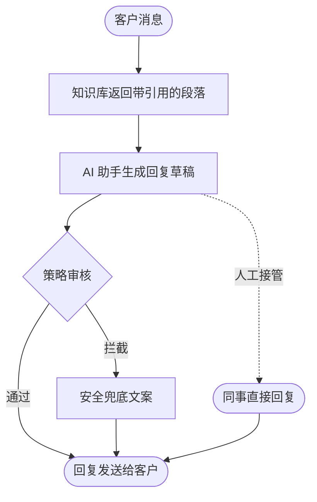

<div align="center">


# Bridge-Agents

**只会发送你愿意为之负责的回复。**

<sub>面向客户对话的自托管、带审核门禁的智能体运行时——编排流程、把关输出、随时转人工。<br />连接成熟企业系统与智能体客服的桥梁。</sub>


<sub>简体中文 · <a href="README.md">English</a></sub>

<br /><br />

[为什么是 Bridge-Agents](#为什么是-bridge-agents) · [怎么工作](#怎么工作) · [演示](#30-秒演示) · [快速开始](#快速开始) · [部署](#部署) · [包与嵌入](#包与嵌入) · [适合谁](#适合谁) · [常见问题](#常见问题) · [路线图](#路线图)

</div>

## 为什么需要 Bridge-Agents

AI 客服又快又便宜，但一句错话就可能带来退款、合规审查或社交媒体上的截图。大多数工具只把机器人交给你，然后祈祷一切顺利。Bridge-Agents 围绕另一个问题设计：**在客户看到回复之前，谁来检查它？**

## 为什么是 Bridge-Agents

| 🛡 **先审核，再发送** | 🙋 **人始终在控制位** |
|---|---|
| 第二个模型按你的策略审核每一版草稿。通过的内容流式发给客户；被拒绝的草稿用兜底文案替换，绝不会展示给客户。 | 同事可以接管会话，AI 正在生成的回复会被取消，然后从客服台或绑定的飞书会话直接回复。客户得到的是真人，而不是重复回复。 |
| 📚 **回答有出处** | 🧩 **改流程，不改代码** |
| 每个回复都基于你的文档。检索器找到相关段落，助手用 [1]、[2] 引用，审核门禁仍会检查措辞。 | 对话流程是可保存的配置。运营可以在拖拽画布上重排；无法编译的流程在生效前就会被拒绝。高级用户仍可用 JSON 编辑。 |

此外还包括：

- **第三方审核**：本地敏感词硬门 + 可选 OpenAI、Azure AI Content Safety、Google Perspective、阿里云、腾讯云审核，支持 fail-open / fail-closed 策略与按厂商的文本分片。
- **主流模型厂商**：OpenAI、Azure OpenAI（原生客户端）、DeepSeek、通义千问、Kimi、智谱 GLM、豆包、文心一言、MiniMax、硅基流动、OpenRouter、Gemini、Anthropic 网关、Ollama 以及任意 OpenAI 兼容接口。
- **客户可直接上手的演示**：昵称进入（无需登录）、左侧多会话切换、图片发送、流式回复、中英双语、明暗主题与手机布局。
- **看得清的客服台**：AI 回复与真人回复标注区分，会话级接管状态可见，图片在记录中直接渲染。

以及那些"无聊但重要"的部分：**数据始终是你自己的**。自托管、默认 SQLite（可选 PostgreSQL/MySQL）、演示模式无外部调用，并提供客户、客服、管理员三种角色。运行时本身也是可 pip 安装、可嵌入的异步库。

## 怎么工作



1. 检索器在你的知识库中找到相关段落，助手生成带引用的回答。
2. 在任何一个字到达客户之前，审核器按你的策略检查草稿——期间文本会被缓冲。
3. 通过的回复自然流式发送；被拒绝的回复变成预先写好的安全兜底。需要真人时，同事接管，AI 停止。

流程是由节点组成的图（`system`、`retrieval`、`agent`、`tools`、`custom`、`sanitize`、`review`、start/end），可可视化编辑或直接改 JSON；完整契约见 [docs/architecture.md](docs/architecture.md)。

## 30 秒演示

> **演示 GIF 位置：[`docs/screenshots/demo.gif`](docs/screenshots/README.md)。**
> 录屏使用真实 UI，不用原型图。

1. 客户填写昵称后问 *"如何激活 Widget Pro？"*——回答以 [1] 引用知识库段落。
2. 客户在左侧新开一个会话问 *"能保证退款吗？"*——草稿承诺退款，审核门禁拦截，客户看到符合政策的兜底话术。
3. 同事从客服台接管，AI 停止写作，真人直接回复；记录中 AI 回复与真人回复分别标注。

## 快速开始

### 一条命令（本地，无需 Docker）

需要 Python 3.11 与 [uv](https://github.com/astral-sh/uv)；首次构建 Web 界面需要 Node.js。

```bash
git clone <repository-url> bridge-agents
cd Bridge-Agents
uv sync
uv run bridge-agents demo
```

首次运行会从 `.env.example` 生成 `.env`，按需构建前端，然后启动确定性 mock 模型和 API。**一个进程同时提供界面和 API**：

- **http://localhost:8000/** —— 客户入口
- **http://localhost:8000/admin** —— 客服台；Studio 在 `/admin/studio`
- **http://localhost:8000/health** —— 健康检查

常用参数：

- `uv run bridge-agents doctor` 检查本地依赖（Python、Node、`.env`、前端构建、端口）。
- `bridge-agents demo --port 18000 --mock-port 8002` 更换端口；`--no-build` 跳过前端构建。
- `make demo` 等价；`make help` 查看其他目标。

### 一条命令（Docker）

```bash
docker compose up --build
```

启动 API、Web 界面和确定性 mock 模型，全程离线、无需 API Key：

- **http://localhost/** —— 客户入口
- **http://localhost/admin** —— 员工入口
- **http://localhost:8000/health** —— API 健康检查

会话保存在命名卷中，`docker compose restart api` 不会丢数据；端口冲突时设置 `WEB_PORT` / `API_PORT`。

### 手动开发（API + Vite 热更新）

```bash
uv sync
cp .env.example .env          # 演示登录需要 ALLOW_DEV_LOGIN=true
uv run bridge-agents init-db
uv run bridge-agents serve --reload        # API + 构建后的界面 :8000
```

前端热更新在第二个终端运行 Vite，它会把 `/api`、`/ws` 代理到 API：

```bash
npm --prefix web install
npm --prefix web run dev                   # http://localhost:5173
```

## 配置

非敏感配置可以放在 `bridge-agents.toml`（参考 [bridge-agents.toml.example](bridge-agents.toml.example)），密钥放在 `.env` 或环境变量。优先级：

**命令行参数 > 环境变量 > `.env` > `bridge-agents.toml` > 默认值**

可用 `--config PATH` 或 `BRIDGE_CONFIG` 指定文件；`bridge-agents init` 生成起始配置，`bridge-agents config check` 校验。

常用开关：

| 变量 | 默认值 | 作用 |
|---|---|---|
| `APP_ENV` | `development` | `production` 关闭演示登录并收紧默认值 |
| `BRIDGE_CONFIG` | `bridge-agents.toml` | 可选的非敏感 TOML 配置文件 |
| `DATABASE_URL` | 本地 SQLite | 切换到 PostgreSQL 或 MySQL |
| `AUTH_VERIFIER` / `JWT_*` | HS256 | 本地密钥、RS256 PEM 或外部 OIDC JWKS |
| `ALLOW_DEV_LOGIN` | `false` | 演示登录；生产环境强制关闭 |
| `LLM_PROVIDER` / `OPENAI_*` | `openai` / mock 模型 | 厂商预设、Endpoint、模型、Key、超时 |
| `MODERATION_*` | 关闭 | 第三方审核密钥、范围与主机白名单 |
| `RAG_*` | hash 嵌入 | 检索分片、Top-K、Embeddings 接口 |
| `WEB_DIST_DIR` | `web/dist` | API 托管的前端目录；留空则不托管静态文件 |
| `LARK_*` | 关闭 | 飞书签名 Webhook 与客服指令 |

完整清单见 [.env.example](.env.example) 与 [docs/architecture.md](docs/architecture.md#configuration)。

前端会请求 `GET /api/v1/meta` 获取服务端版本、`api_version` 与 `min_web_version`，因此独立部署的前端可以检测版本不匹配。

## 部署

Python 包与 GUI 分开分发：GUI 由 nginx/CDN 托管，服务端保持普通 pip 安装：

| 产物 | 内容 |
|---|---|
| `bridge-agents` | 核心 Python 运行时（不含服务端依赖） |
| `bridge-agents-server` | FastAPI 服务端、数据库模型、CLI；固定匹配的核心版本 |
| `bridge-agents-web-<version>.tar.gz` | 构建好的静态 GUI，供 nginx/CDN 使用（从不打进 wheel） |

```bash
python -m venv /opt/bridge-agents/.venv
/opt/bridge-agents/.venv/bin/pip install "bridge-agents-server[postgres]"

bridge-agents init --config /etc/bridge-agents/bridge-agents.toml \
    --env-file /etc/bridge-agents/bridge-agents.env
bridge-agents init-db --config /etc/bridge-agents/bridge-agents.toml
bridge-agents config check --config /etc/bridge-agents/bridge-agents.toml
bridge-agents serve --config /etc/bridge-agents/bridge-agents.toml
```

标准拓扑是 **nginx 托管静态 GUI，并把 `/api`、`/ws` 反向代理到 `127.0.0.1:8000`** —— 同源，无需 CORS。复制 [deploy/bridge-agents.service](deploy/bridge-agents.service) 与 [deploy/nginx.conf](deploy/nginx.conf)，并按 [deploy/README.md](deploy/README.md) 的生产清单逐项核对。

在仓库中执行 `make release` 可一次构建两个 wheel 与带版本号的 Web 静态包。

## 包与嵌入

本仓库构建两个 Python 发行包和一个 Web 静态产物：

- **`bridge-agents`**（`import bridge_agents`）——审核门禁 pipeline、流程图校验、检索、鉴权校验器、审核适配器、注入防护、限流、可嵌入的 `AgentRuntime` 与测试替身。
- **`bridge-agents-server`** —— FastAPI 应用、数据库模型与 `bridge-agents` CLI；extras：`[postgres]`、`[mysql]`。
- **Web UI** —— `web/` 下的 React/Vite，构建为 `web/dist` 并以静态包发布。

两个发行包尚未发布到 PyPI，可从仓库构建/安装：

```bash
uv build                                                   # 两个 wheel 输出到 dist/
pip install --find-links dist bridge-agents                # 仅核心库
pip install --find-links dist "bridge-agents-server[postgres]"
uv sync                                                    # 应用 + CLI
uv run bridge-agents version
```

不用 HTTP 栈时，直接嵌入运行时：

```python
from bridge_agents.runtime import AgentRuntime

async with AgentRuntime(llm=my_chat_model) as runtime:
    answer = await runtime.reply("如何激活 Widget Pro？")
    async for event in runtime.stream("可以退款吗？"):
        ...
```

已有 FastAPI 服务时，也可以挂载服务端：

```python
from app.main import create_app

app.mount("/bridge-agents", create_app())
```

`bridge_agents.testing` 自带确定性的 `FakeChatModel` / `FakeModerator`，单测无需网络或 API Key。库说明见 [packages/bridge_agents/README.md](packages/bridge_agents/README.md)。

## 开发

需要 Python 3.11、[uv](https://github.com/astral-sh/uv)，Web UI 需要 Node 20+。

```bash
make demo        # mock 模型 + API + 构建后的界面 :8000
make test        # pytest（312 项离线测试）
make lint        # ruff check + 格式检查
make check       # lint + 测试 + 前端构建
make release     # wheel + 前端静态发布包
make help        # 查看全部目标
```

后端结构：`app/`（FastAPI、模型、服务、CLI）、`packages/bridge_agents/`（核心库）、`web/`（React UI）、`tests/`、`deploy/`、`docs/`。质量门禁：pytest（`app/core` 与库合计 91% 覆盖率）、ruff、仓库内容清洗门禁，以及 lint/测试/密钥/前端构建的 CI。

从这里开始读：

- [docs/architecture.md](docs/architecture.md) —— API、运行时节点、配置、质量门禁
- [docs/design-decisions.md](docs/design-decisions.md) —— 为什么这样设计
- [deploy/README.md](deploy/README.md) —— 生产拓扑与检查清单
- [CHANGELOG.md](CHANGELOG.md) —— 最近变更

## 适合谁

| | Bridge-Agents | 常见低代码机器人平台 |
|---|---|---|
| 围绕"先审核回复"设计 | ✅ 审核门禁在运行时内部 | 通常生成后再做审核 |
| 人工接管会中断 AI 回复 | ✅ 接管即取消待发送回复 | 取决于产品 |
| 对话流程属于代码与评审 | ✅ 保存配置，生效前校验 | 通常托管在平台画布中 |
| 回答基于你的文档 | ✅ 混合检索 + 引用 + 可编辑知识库 | 常见仅靠提示词或独立插件 |
| 不重部署即可换模型/提示词 | ✅ Studio 设置，下一条消息生效 | 通常要改环境并重启 |
| 自托管、可嵌入 | ✅ 运行时可 pip 安装，GUI 为静态产物，一条命令演示 | 多为封闭 SaaS |

低代码平台适合做拖拽原型；Bridge-Agents 面向回复带有商业或法律责任的团队——"机器人说的"不是可接受的答案。

## 当前进度

**0.1.0 仍在开发中。** 现在已经可用 vs. 下一步：

| 已具备 | 下一步 |
|---|---|
| 审核门禁运行时：缓冲、重试、兜底、安全默认值 | 数据库迁移（Alembic）与升级命令 |
| 第三方审核：本地硬门 + 5 家厂商、分片、失败策略 | 浏览器 OIDC 登录流程（JWKS/RS256 令牌校验已具备） |
| 模型厂商预设：OpenAI、Azure OpenAI 及另外 13 个（OpenAI 兼容厂商 + 自定义网关） | PyPI 发布与容器镜像（server + web）及发布自动化 |
| RAG：引用、上传、重建索引与搜索预览 | Slack 适配器与公开 Webhook API |
| 可视化流程编辑器：节点面板、自动布局、JSON 回退 | 可嵌入客户组件、重排与多租户存储 |
| 客服台：接管、AI/真人标注、图片记录 | Kubernetes/Helm 部署选项 |
| 客户演示：昵称进入、多会话记录、附件、流式回复 | — |
| 中英双语、响应式、明暗主题 | — |
| 飞书渠道：签名 Webhook 与双向真人回复 | — |
| 打包：两个 pip 包、TOML/环境变量配置、CLI、静态前端包、systemd/nginx 模板 | — |
| 离线一条命令演示与 Docker Compose 栈 | — |
| 312 项离线测试、91% 覆盖率、ruff 与内容清洗门禁 | — |

## 常见问题

**这是聊天机器人搭建器吗？**
不是。它是聊天产品背后的运行时：决定 AI 能说什么、谁能改流程、什么时候转真人。

**试用需要 API Key 吗？**
不需要。默认使用确定性 mock 模型，新检出的仓库可离线运行。

**必须用 Docker 吗？**
不需要。`uv sync && uv run bridge-agents demo` 即可本地跑起完整演示；Docker Compose 是同样离线的替代方案。

**演示里有登录界面吗？**
没有。客户填写昵称后即可开始聊天（昵称用于客服称呼，并让每个浏览器拥有独立会话）。内部演示登录仅用于开发，生产环境关闭。

**两个入口在哪里？**
`/` 是客户聊天，不含员工导航；`/admin` 是员工入口：客服台在 `/admin`，Studio（流程、知识库、设置）在 `/admin/studio`。

**支持哪些模型和审核厂商？**
模型预设覆盖 OpenAI、Azure OpenAI（原生客户端）、DeepSeek、通义千问、Kimi、智谱 GLM、豆包、文心一言、MiniMax、硅基流动、OpenRouter、Gemini、Anthropic 网关、Ollama 及任意 OpenAI 兼容接口。审核支持本地敏感词 + OpenAI 兼容、Azure、Perspective、阿里云、腾讯云适配器。

**不改代码能换模型或客服提示词吗？**
可以。Studio → 配置可修改厂商/模型/采样/API Key 与客服系统提示词，保存后下一条消息生效；API Key 加密存储，接口不会返回明文。

**真人可以回复客户吗？**
可以。客服台实时显示会话记录，接管后回复框发送真实消息，客户立即收到；绑定飞书会话后同样可用。

**能基于我自己的文档回答吗？**
可以。检索器索引知识目录（默认从 `docs/kb` 播种，可在 Studio 编辑），助手会引用使用的段落。默认嵌入器确定性且离线；`RAG_EMBEDDER=openai` 可接任意 `/v1/embeddings`。

**非工程师能改流程吗？**
可以。可视化编辑器保存前会校验配置；高级用户仍可使用 JSON 编辑器。

**能上生产吗？**
还不能。0.1.0 是第一个版本；参见[进度表](#当前进度)与[部署检查清单](deploy/README.md)。

**界面支持中文、手机、深色模式吗？**
支持。中英文可切换并记住选择，布局响应式下探到 360px，明暗主题在首屏渲染前生效。

## 安全与隐私

仓库不包含任何凭据或客户数据。演示登录不会在生产挂载，客户与员工角色隔离，厂商密钥只存在于环境变量（或加密的运行时设置）中，流程的任何变更在生效前都会校验。漏洞报告见 [SECURITY.md](SECURITY.md)。

## 路线图

- [x] 客户 / 客服 / 管理员三角色安全访问
- [x] 带重试、兜底和安全默认值的审核门禁运行时
- [x] Admin API 编辑、校验、重置会话流程
- [x] 实时会话：session、消息、图片与 WebSocket 流式输出
- [x] 浏览器演示：聊天、流程编辑器、带接管的客服台
- [x] 人工接管时取消进行中的 AI 回复
- [x] RAG：混合检索、引用、上传与重建索引
- [x] 飞书渠道：签名事件与双向真人回复
- [x] OpenAI / Azure / Perspective / 阿里云 / 腾讯云第三方审核
- [x] 主流模型厂商预设（含 Azure OpenAI）
- [x] 客户演示：昵称、多会话记录与图片附件
- [x] 中英双语、响应式 UI 与明暗主题
- [x] 打包、CLI、TOML 配置、静态前端发布与部署模板
- [x] 离线一条命令演示与 Docker Compose 栈
- [ ] 数据库迁移（Alembic）与 `db upgrade` 命令
- [ ] 浏览器 OIDC 登录流程
- [ ] PyPI 发布、容器镜像与发布自动化
- [ ] Slack 适配器、公开 Webhook API 与可嵌入组件
- [ ] 重排、多租户存储与 Kubernetes/Helm 选项

## 许可证

Apache-2.0，见 [LICENSE](LICENSE)。

## 出处说明

Bridge-Agents 是作者为内部生产系统构建的客户对话运行时的独立、清洗后重写版本，经书面许可发布。仓库不包含任何专有代码、数据、凭据或客户信息。
