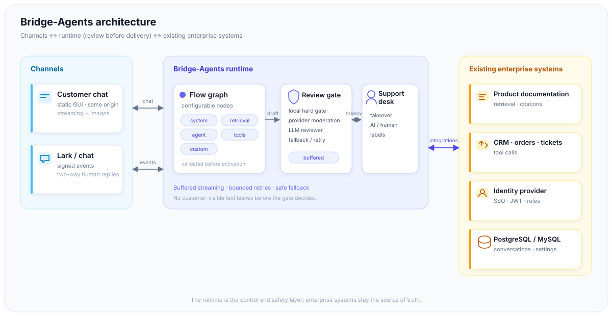
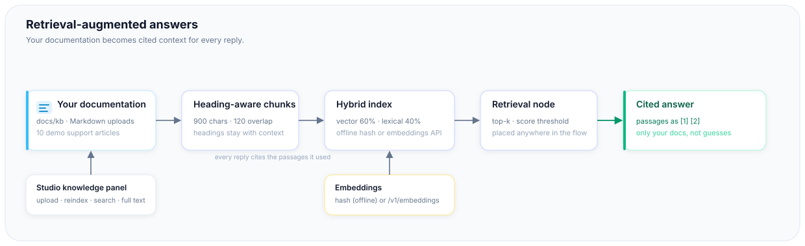
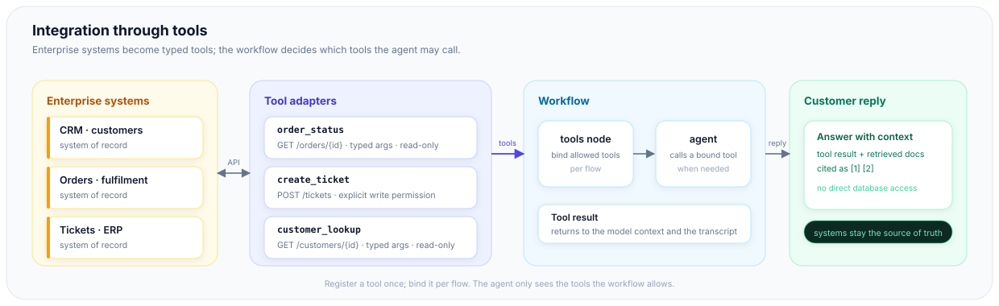

<div align="center">


# Bridge-Agents

**面向客服的可视化 AI 工作流，回答基于你的文档。**

<sub>在拖拽画布上设计对话流程，让每个回答都引用自己的知识库，<br />并把工作流接到企业已有的系统上。</sub>


<sub>简体中文 · <a href="README.md">English</a></sub>

<br /><br />

[设计总览](#设计总览) · [架构](#架构) · [可视化工作流](#支柱一--可视化设计工作流) · [RAG](#支柱二--用文档支撑回答) · [企业集成](#支柱三--通过-tools-对接企业系统) · [快速开始](#快速开始) · [配置与部署](#配置与部署) · [常见问题](#常见问题) · [路线图](#当前状态与路线图)

</div>

## 为什么需要 Bridge-Agents

企业缺的不是 AI 模型，而是**让业务团队不写代码就能设计客服工作流**、并且**让回答基于企业自己的文档**的地方。三类人需要协同工作：

- **运营人员**需要在不提软件工单的前提下，设计并调整工作流的路由、知识、语气和转人工策略；
- **客服团队**需要回答引用公司自己的文档，而不是编造政策或依赖通用模型；
- **IT 与平台团队**希望工作流与已有的身份系统、CRM、订单、工单、文档系统**并存**，而不是替换它们。

Bridge-Agents 围绕两个产品支柱设计——可视化工作流编辑器与一等公民的检索能力——再加上让它们真正落地的企业集成。

## 设计总览

| 🧩 **可视化工作流** | 📚 **内置 RAG** | 🔌 **集成而非替换** |
|---|---|---|
| 对话流程是保存的配置，不是代码。运营把节点拖到画布上、连线、用通俗表单配置；无法编译的流程在生效前被拒绝。保存后热切换进运行时，无需重新部署。 | 文档是产品的一等能力：上传客服文章或指向已有文档目录，用标题感知分块与混合检索召回段落，助手回答时带上 `[1]`、`[2]` 引用。演示自带 10 篇离线文档。 | 身份来自企业 IdP，动作通过工作流中绑定的 typed **tools** 完成，数据进入企业数据库，GUI 是放在企业 nginx 后的静态文件。自托管、默认 SQLite、无厂商锁定。 |

## 架构



产品刻意拆成四个平面：

- **控制平面** — 可视化流程图、节点配置与客服提示词，归运营所有；保存前校验，保存后热切换进运行时。
- **知识平面** — 文档摄取、标题感知分块、混合索引、检索节点与引用渲染。
- **交付平面** — 模型调用、工具执行、渠道投递与客服台（[`packages/bridge_agents`](packages/bridge_agents)）。
- **集成平面** — 把企业 API 封装成 typed tools，再加上身份、数据库与静态 GUI 部署，让产品嵌进企业现有栈。

## 支柱一 — 可视化设计工作流

核心出发点是：**流程是配置，不是一次发布**。运营在 Studio（`/admin/studio`）里工作，而不是在代码库里。

### 流程是经过校验的图

一次对话是一张节点图；画布编辑的 JSON 配置，就是运行时编译的那一份。

| 节点 | 运营用它来做什么 |
|---|---|
| `system` | 设置助手角色提示词 |
| `retrieval` | 用知识库支撑回答（Top-K、分数阈值） |
| `agent` | 生成面向客户的回复 |
| `tools` | 让助手调用已注册的系统工具 |
| `custom` | 增加一次模型步骤（翻译、分类、改写） |
| `sanitize` | 可选护栏：屏蔽敏感词或调用第三方审核 |
| `review` | 可选护栏：审核、重试或改写后再发送 |
| `start` / `end` | 入口与出口 |

运营从节点面板添加节点、连线（含 `respond`、`tool_call`、`pass`、`block` 等条件句柄），拖动或自动布局，在通俗的表单里填写字段；高级用户还可以直接编辑同一份配置的 JSON。

**通过校验避免错误配置：** 图在保存前会被编译校验。引用不存在的节点、缺少 agent 角色、路由不通的边都会被拒绝，旧流程继续运行；保存后新图热切换，无需重新部署或重启。

### Studio 覆盖运营的其余工作

- **知识** — 上传文档、重建索引、搜索预览；也可以把 `DOCS_DIR` 指向已有的文档目录。
- **模型** — 选择厂商预设（OpenAI、Azure OpenAI 等 15 个）与 Endpoint；填写 API Key 后自动从服务商获取可用模型并以下拉框选择（Azure 列出部署）。预设地址已按厂商官方文档核对，见 [docs/providers.md](docs/providers.md)。可保存多套已验证的 API 配置，并在右侧列表选择整个系统当前使用哪一套；API Key 加密存储，接口不回显。
- **客服提示词** — 提示词是流程图的 `system` 节点，在流程编辑器中修改，**不在配置页修改**；配置页只管理模型 API。
- **角色与语言** — 客服与管理员可编辑，客户只能对话；界面中英双语、明暗主题、移动端自适应。

画布上还提供可选的 `sanitize` / `review` 护栏节点；默认流程不依赖它们。

### 目前仍需开发者的部分

新的**系统能力**——接入一个新的 CRM、增加自定义节点类型、增加新渠道——目前是 Python 扩展，注册后由运营在流程里绑定和配置。把这些集成做成声明式（OpenAPI/HTTP 工具定义、插件式节点）已列入路线图，让更多集成工作从 IT 转移到运营。

## 支柱二 — 用文档支撑回答

检索是产品的一等能力，而不是外挂。上传客服文档，或把 `DOCS_DIR` 指向已有的文档目录，`retrieval` 节点就会把带引用的段落交给助手。



### Studio 中的知识库

- **上传与编辑** — 添加 Markdown/文本文件、重建索引、搜索预览、查看文档全文、删除过期文章。
- **标题感知分块** — 900 字符分块、120 字符重叠；标题跟随所属章节，引用更易读。
- **混合检索** — 向量相似度（60%）+ 词法匹配（40%）；`RAG_TOP_K`、`RAG_MIN_SCORE` 可按部署与 `retrieval` 节点配置。
- **引用** — 召回的段落带引用标记交给模型；内置提示词要求助手用 `[1]`、`[2]` 引用，并在文档未覆盖时明确说明。
- **嵌入** — 默认确定性离线 hash 嵌入；设置 `RAG_EMBEDDER=openai` 可接任意 `/v1/embeddings` 接口。

### 工作流中的检索

- 把 `retrieval` 节点拖到 `agent` 节点之前（或任何合适的位置），在节点面板配置 Top-K 与分数阈值。
- 节点会针对最新客户消息召回段落并注入模型上下文，引用会保留在最终回复里。
- 也可以使用内置 `search_docs` 工具，让助手直接查询同一个索引。

### 演示知识库

演示自带 10 篇虚构客服文档（账户、账单、退款、桌面同步、登录/SSO、API/Webhook、安全合规、SLA），共 64 个索引分块，因此检索链路离线即可体验。

## 支柱三 — 通过 tools 对接企业系统

Bridge-Agents 是企业已有系统**旁边的一层**，而不是替代品。集成设计的核心是 **tools**：每个企业能力被封装成 typed tool，工作流的 `tools` 节点决定本次流程允许调用哪些工具，助手在需要真实系统数据或执行动作时调用它们。



### 一个工具集成如何工作

1. **注册工具** — 内置适配器或少量 Python 扩展暴露一个企业能力：名称、给模型看的描述、typed 参数、环境变量中的凭据、读写范围。
2. **在流程中绑定** — 运营在 `tools` 节点面板勾选本次工作流允许使用的工具；图里需要有 `tool_call` 路由，助手才能发起调用。
3. **对话中调用** — 模型只能看到已绑定的工具，按需调用；参数会按工具 schema 校验。
4. **返回结果** — 工具结果回到模型上下文，并流式写入对话记录；最终回答可以同时结合实时系统数据与检索到的文档。

### 工具设计原则

- **窄而明确** — 一个工具对应一个业务操作（`order_status`、`create_ticket`、`customer_lookup`），参数使用模型必须遵守的 JSON schema。
- **默认只读** — 只读工具是推荐起点；写操作必须显式暴露，并且只在允许它的流程里可用。
- **企业系统仍是事实来源** — 工具调用既有 API；除非显式调用写工具，运行时不复制或改写企业数据。
- **凭据留在服务端** — 工具密钥放在环境变量，不进入流程 JSON 或浏览器。
- **调用可见** — 工具调用与结果会流式展示并写入对话记录，客服能看到助手实际做了什么。

### 今天已具备

内置工具：`get_current_time`、`calculate`、`search_docs`（RAG 检索工具）。管理端 API 提供工具目录，流程节点面板按节点勾选工具，工具调用与结果会流式写入对话。新的企业 API 目前通过少量 Python 工具接入；**声明式 HTTP/OpenAPI 工具**是下一步，让简单的读写接口不写 Python 也能注册。

| 集成面 | 连接方式 | 状态 |
|---|---|---|
| 身份 | 复用企业 IdP：HS256（本地）、RS256 PEM 或外部 OIDC JWKS；三种角色（客户、客服、管理员） | 已支持；浏览器 OIDC 登录流程下一步 |
| 知识 | `DOCS_DIR` 指向现有文档目录，或在 Studio 上传；离线 hash 嵌入或任意 `/v1/embeddings` | 已支持 |
| 系统 API / tools | 工作流的 `tools` 节点绑定已注册工具；每个工具封装一个企业 API、使用 typed 参数，结果回到模型与对话记录 | Python 注册工具已支持；声明式 HTTP/OpenAPI 工具下一步 |
| 工具目录 | 内置 `get_current_time` / `calculate` / `search_docs`，以及 Python 注册的适配器；管理端 API 供流程节点面板读取 | 已支持 |
| 渠道 | 同源 Web 聊天（静态 GUI 放在企业 nginx 后）与签名飞书渠道、双向真人回复 | 已支持；Slack 与通用 Webhook 下一步 |
| 存储 | 默认 SQLite；可选 PostgreSQL / MySQL；上传文件落盘或挂载卷 | 已支持 |
| 部署 | pip/uv 包（`bridge-agents`、`bridge-agents-server`）、systemd、nginx 反代、Docker Compose；GUI 为静态产物 | 已支持 |
| API 契约 | `/api/v1` 与 `/ws` 的 REST + WebSocket；`/api/v1/meta` 版本握手；`/health` | 已支持 |
| 配置 | TOML + 环境变量，标准优先级；密钥只放环境变量或加密的运行时设置 | 已支持 |
| 扩展性 | Token 校验器、聊天模型（OpenAI 兼容）、审核适配器、渠道等协议；`create_app()` 与 `AgentRuntime` | 已支持 |

### 非侵入式集成

- **企业系统仍是事实来源。** 运行时通过工具读取，除非运营配置的工具明确写入，否则不会改动企业数据；只读连接是推荐的起点。
- **演示/离线模式数据不出内网。** 默认模型、嵌入器和渠道都在本地运行，外部厂商按需开启。
- **不需要新增网关。** 把静态 GUI 部署进现有 nginx，将 `/api`、`/ws` 反代到私有端口上的 Python 服务即可；同源，无需 CORS。
- **版本兼容是显式的。** 前端读取 `/api/v1/meta`，只要满足 `min_web_version`，GUI 与服务端可以独立发版。
- **密钥默认不进入 UI 和数据库。** 密钥存放在环境变量；通过 Studio → 设置保存时加密存储。

## 一个故事，三个支柱

1. 运营打开 Studio，把 `retrieval` 节点拖到 agent 之前，上传客服文档并保存。流程图通过校验并热切换，无需发布。*（工作流）*
2. 客户问"如何激活 Widget Pro？"检索返回激活说明段落，助手回答时带上 `[1]` 引用。*（RAG）*
3. 客户询问订单状态，`tools` 节点调用既有订单系统，回答结合工具结果与政策引用。*（工作流 + 集成）*
4. 身份来自公司 IdP；会话存入公司数据库；GUI 由公司 nginx 提供。*（集成）*

## 快速开始

### 一条命令（本地，无需 Docker）

需要 Python 3.11、[uv](https://github.com/astral-sh/uv)，首次构建前端需要 Node.js。

```bash
git clone <repository-url> bridge-agents
cd bridge-agents
uv sync
uv run bridge-agents demo
```

首次运行会生成 `.env`、构建前端，并启动确定性 mock 模型与 API。一个进程同时提供：

- **http://localhost:8000/** —— 客户聊天
- **http://localhost:8000/admin** —— 客服台；Studio 在 `/admin/studio`
- **http://localhost:8000/health** —— 健康检查

`bridge-agents demo --port 18000 --mock-port 8002`、`--no-build`、`make demo`、`make help` 与 `bridge-agents doctor` 覆盖常见变体。

### 一条命令（Docker）

```bash
docker compose up --build
```

客户界面 **http://localhost/**，员工入口 **http://localhost/admin**，API 健康检查 **http://localhost:8000/health**。整套离线运行，会话保存在命名卷。

### 手动开发

```bash
uv sync
cp .env.example .env          # 演示登录需要 ALLOW_DEV_LOGIN=true
uv run bridge-agents init-db
uv run bridge-agents serve --reload       # API + 构建后的界面 :8000
npm --prefix web install && npm --prefix web run dev   # Vite :5173
```

## 配置与部署

配置优先级：**命令行参数 > 环境变量 > `.env` > `bridge-agents.toml` > 默认值**。`bridge-agents init` 生成起始 TOML 与只含密钥的 `.env`；`bridge-agents config check` 校验生效配置（生产不安全默认值会报错）。完整变量见 [.env.example](.env.example)、[bridge-agents.toml.example](bridge-agents.toml.example) 与 [docs/architecture.md](docs/architecture.md)。

部署时 GUI 与 Python 分离：

| 产物 | 内容 |
|---|---|
| `bridge-agents` | 核心运行时（不含服务端依赖） |
| `bridge-agents-server` | FastAPI 服务端、数据库模型、CLI；固定匹配的核心版本 |
| `bridge-agents-web-<version>.tar.gz` | 构建好的静态 GUI，供 nginx/CDN 使用（从不进 wheel） |

```bash
pip install --find-links dist "bridge-agents-server[postgres]"
bridge-agents init --config /etc/bridge-agents/bridge-agents.toml \
    --env-file /etc/bridge-agents/bridge-agents.env
bridge-agents init-db --config /etc/bridge-agents/bridge-agents.toml
bridge-agents config check --config /etc/bridge-agents/bridge-agents.toml
bridge-agents serve --config /etc/bridge-agents/bridge-agents.toml
```

复制 [deploy/bridge-agents.service](deploy/bridge-agents.service) 与 [deploy/nginx.conf](deploy/nginx.conf)，按 [deploy/README.md](deploy/README.md) 的生产清单逐项核对。`make release` 一次构建两个 wheel 与带版本号的 Web 静态包。

## 包与嵌入

两个 Python 发行包 + 一个静态 GUI：

- **`bridge-agents`** —— 工作流 pipeline、流程图校验、检索、工具注册表、鉴权校验器、审核适配器、注入防护、限流、可嵌入的 `AgentRuntime` 与测试替身。
- **`bridge-agents-server`** —— FastAPI 应用、数据库模型与 CLI；extras：`[postgres]`、`[mysql]`。
- **Web UI** —— `web/` 下的 React/Vite，以静态包发布。

```python
from bridge_agents.runtime import AgentRuntime

async with AgentRuntime(llm=my_chat_model) as runtime:
    answer = await runtime.reply("如何激活 Widget Pro？")
    async for event in runtime.stream("可以退款吗？"):
        ...
```

已有 FastAPI 服务时，也可挂载服务端：

```python
from app.main import create_app

app.mount("/bridge-agents", create_app())
```

`bridge_agents.testing` 自带确定性 `FakeChatModel` / `FakeModerator`。详见 [packages/bridge_agents/README.md](packages/bridge_agents/README.md)。

## 适合谁

| | Bridge-Agents | 常见低代码机器人平台 |
|---|---|---|
| 可视化工作流编辑 | ✅ 校验通过后热切换的拖拽画布 | 可以，但通常封闭且与代码绑定 |
| 带引用的文档问答 | ✅ 内置 RAG、上传/重建索引、引用 | 通常是外挂或仅靠提示词 |
| 融入企业现有栈 | ✅ 面向 CRM/订单/工单的 typed tools、IdP、现有文档、数据库、自有 nginx | 多为封闭 SaaS |
| 人工接管会打断 AI | ✅ 接管即取消待发送回复 | 取决于产品 |
| 自托管、可嵌入 | ✅ pip 包 + 静态 GUI + 一条命令演示 | 通常不支持 |

低代码平台适合做原型；Bridge-Agents 面向回复带有商业或法律责任的团队——"机器人说的"不是可接受的答案。

## 当前状态与路线图

**0.1.0 开发中。** 已经可用：

| 已具备 | 下一步 |
|---|---|
| 可视化流程编辑器：保存前校验、节点面板、自动布局、JSON 回退 | 流程版本历史与审批 |
| RAG：标题感知分块、混合检索、引用、上传/重建索引与全文预览 | 重排与多租户知识库 |
| Studio：知识库面板、15 个模型厂商预设、已保存并验证的 API 配置 | 浏览器 OIDC 登录流程（JWKS/RS256 校验已具备） |
| 基于 tools 的企业集成：工具目录、`tools` 节点绑定、工具调用流式记录 | 声明式 HTTP/OpenAPI 工具，让新企业 API 免写 Python |
| 客户演示：昵称、多会话记录、附件、流式回复 | PyPI 发布、容器镜像与发布自动化 |
| 客服台：接管、AI/真人标注、图片记录 | Slack 适配器、通用 Webhook API 与可嵌入组件 |
| 客服台：接管、AI/真人标注、图片记录 | 数据库迁移（Alembic）与 `db upgrade` 命令 |
| 客户演示：昵称进入、多会话记录、附件 | Kubernetes/Helm 部署选项 |
| 飞书渠道、中英双语、响应式、明暗主题 | — |
| 打包、CLI、TOML 配置、静态 GUI 发布、systemd/nginx 模板 | — |
| 336 项离线测试、91% 覆盖率、ruff 与内容清洗门禁 | — |

## 常见问题

**非程序员真的能改 AI 流程吗？**
对话行为可以：路由、提示词、知识、工具、模型 API 与转人工都能在 Studio 编辑，保存前校验、无需重部署即可生效。新的**集成**（接入新系统 API、增加自定义节点）目前还需要少量 Python 扩展；声明式 HTTP 工具是下一步。

**回答怎么基于我的文档？**
在 Studio 上传 Markdown/文本文件，或把 `DOCS_DIR` 指向已有文档目录。`retrieval` 节点用标题感知分块和混合检索召回段落，回答以 `[1]`、`[2]` 引用这些段落。修改文档后在 Studio 重建索引即可；演示自带 10 篇离线文档。

**可以加护栏吗？**
可以，按需添加：画布提供 `sanitize` 与 `review` 节点，用于敏感词、第三方审核或 LLM 策略检查；默认流程不依赖它们。

**必须用某一家模型厂商吗？**
不需要。任意 OpenAI 兼容接口都可用，Azure OpenAI 有原生客户端，Studio 内置 15 个厂商预设；Anthropic 可通过兼容网关接入。

**会替换我的 CRM / 订单系统 / IdP 吗？**
不会。既有系统会被封装成 typed **tools**，工作流绑定允许的工具，助手在需要时调用，结果回到对话。企业的 IdP、文档、数据库与 Web 服务器都会被复用；只读工具是推荐起点。

**试用需要 Docker 或 API Key 吗？**
不需要。`uv sync && uv run bridge-agents demo` 离线运行确定性 mock 模型；Docker Compose 是替代方案。

**能上生产吗？**
0.1.0 是第一个版本。运行时与部署路径可用；受监管的生产上线应等待路线图中的审计/审批、OIDC、迁移与发布工作。参见 [deploy/README.md](deploy/README.md)。

**两个入口在哪里？**
`/` 是客户聊天（无员工导航）；`/admin` 是员工入口（客服台）；`/admin/studio` 是控制平面（流程、知识、设置）。

## 安全与隐私

仓库不包含任何凭据或客户数据。演示登录在生产禁用，角色隔离，厂商密钥只存在于环境变量（或加密的运行时设置），工作流变更生效前校验，并可用白名单限制厂商 URL。漏洞报告见 [SECURITY.md](SECURITY.md)。

## 文档

- [docs/architecture.md](docs/architecture.md) —— API、运行时节点、配置、质量门禁
- [docs/design-decisions.md](docs/design-decisions.md) —— 为什么这样设计
- [deploy/README.md](deploy/README.md) —— 生产拓扑与检查清单
- [packages/bridge_agents/README.md](packages/bridge_agents/README.md) —— 库用法
- [CHANGELOG.md](CHANGELOG.md) —— 最近变更
- [docs/releasing.md](docs/releasing.md) —— 发布清单、PyPI/GHCR 发布与回滚
- [docs/providers.md](docs/providers.md) —— 已核对的模型服务地址与模型获取说明

## 许可证

Apache-2.0，见 [LICENSE](LICENSE)。

## 出处说明

Bridge-Agents 是作者为内部生产系统构建的客户对话运行时的独立、清洗后重写版本，经书面许可发布。仓库不包含任何专有代码、数据、凭据或客户信息。
