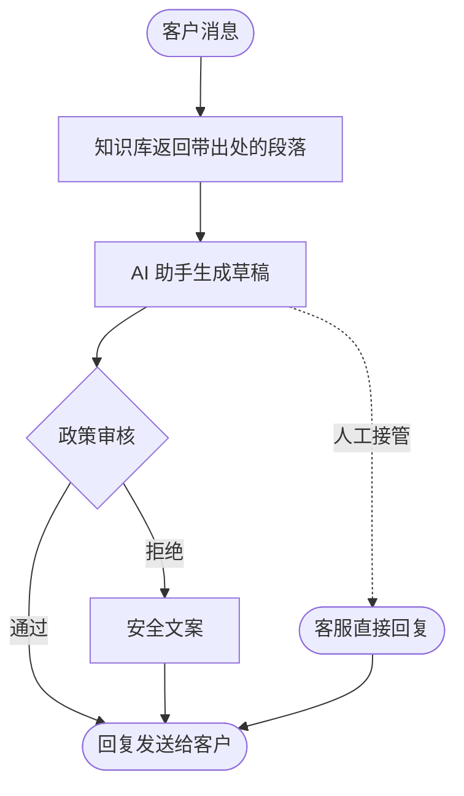

<div align="center">


# Bridge-Agents

**能对客户发出去的 AI 回复，才值得发出去。**

<sub>面向客户对话的自托管 Agent 运行时 —— 编排流程、审核输出、交接给人工。</sub>


<sub><a href="README.md">English</a> · 简体中文</sub>

<br /><br />

[为什么需要 Bridge-Agents](#为什么需要-bridge-agents) · [怎么工作](#怎么工作) · [演示](#30-秒演示) · [现在就试](#现在就试) · [常见问题](#常见问题) · [路线图](#路线图)

</div>

## 为什么需要 Bridge-Agents

AI 客服很快、很便宜，但一句不该说的话，就可能变成一次退款、一次合规事故，
或者一张被截图传遍社交网络的对话。多数工具只是给你一个机器人，然后祈祷它
别出事。Bridge-Agents 围绕另一个问题设计：**客户看到回复之前，谁来检查它？**

## Bridge-Agents 给你什么

| 🛡 **发送前先审核** | 🙋 **人始终有最终控制权** |
|---|---|
| 第二个模型按你的政策审核每一份草稿：通过的文本才流式发给客户；被拒绝的回复会被替换成预设的安全文案，客户永远看不到草稿。 | 客服可以随时接管会话，AI 正在生成的回复会被取消，随后在管理端或绑定的飞书群里直接回复；客户对接的是人，而不是另一条重复的机器回复。 |
| 📚 **回答带出处** | 🧩 **改流程，不用改代码** |
| 每条回复都基于你的文档：检索器找出相关段落，助手用 [1]、[2] 标注出处，审核门禁仍然检查措辞。 | 对话流程是一份经过校验的配置。运营可以重排流程；跑不起来的流程会在生效前被拒绝。*（拖拽式编辑器开发中；JSON 编辑器已可用）* |

再加上那些不炫但重要的部分：**数据留在你自己手里。** 可自托管、默认单机
数据库、演示模式不产生任何外部调用，并且区分客户、客服、管理员三种角色。

## 怎么工作



1. 检索器从知识库找出相关段落，AI 助手据此生成带出处的回复草稿。
2. 在任何一个字到达客户之前，审核器按你的政策检查草稿 —— 审核期间草稿被
   扣住不发送。
3. 通过的回复自然流式到达客户；被拒绝的回复换成预设的安全文案。当会话需要
   真人时，客服一键接管，AI 立刻停止。

## 30 秒演示

> **demo GIF 位置：[`docs/screenshots/demo.gif`](docs/screenshots/README.md)。**
> 演示在发布时从真实界面录制，不使用合成截图；在录制到位前，下面就是它展示的
> 完整流程。

演示讲的故事：

1. 客户问：*"如何激活 Widget Pro？"* —— 回答以 [1] 标注知识库段落出处。
2. 另一位客户问：*"你能保证退款吗？"* —— 草稿作出承诺，审核门禁拦下它，
   客户看到的是符合政策的安全文案。
3. 客服在管理端接管，AI 停止生成，由真人直接回复。

运行 `docker compose up --build`，然后从两个入口之一进入：

- **`http://localhost/` —— 用户入口：** 只有聊天，没有客服/管理导航。
- **`http://localhost/admin` —— 客服/管理员入口：** 客服台，Studio（流程 + 知识库）
  在 `/admin/studio`。

Studio → Knowledge 可以看到检索索引、检索预览与文档上传；Studio → 配置可以不
重新部署就更换模型和客服提示词。界面提供英文与简体
中文两套文案，用顶栏的 EN / 中文 切换，选择会被记住。

## 现在就试

先拿代码：

```bash
git clone <repository-url> bridge-agents
cd bridge-agents
```

### 一条命令（Docker）

```bash
docker compose up --build
```

API、网页 demo 与确定性 mock 模型一起启动，无 API Key、完全离线可用。打开
http://localhost 看界面；API 与健康检查在 http://localhost:8000。

```bash
curl http://127.0.0.1:8000/health
# {"status":"ok","version":"0.1.0"}
```

会话数据保存在命名卷中，`docker compose restart api` 后依然存在；默认端口被
占用时可用 `WEB_PORT` / `API_PORT` 覆盖。

### 本地 Python

需要 Python 3.11 与 [uv](https://github.com/astral-sh/uv)：

```bash
uv sync
cp .env.example .env
```

在 `.env` 里打开 `ALLOW_DEV_LOGIN=true`，然后：

```bash
uv run python scripts/init_db.py
uv run uvicorn app.main:app --reload
```

前端开发：界面在 `web/`（React + TypeScript），执行
`cd web && npm install && npm run dev`，Vite 会把 `/api` 与 `/ws` 代理到本地
API。接口、配置、质量门禁等工程细节见
[docs/architecture.md](docs/architecture.md)。

## 适合谁

| | Bridge-Agents | 典型低代码机器人平台 |
|---|---|---|
| 设计重心是"审核回复"而不只是"生成回复" | ✅ 审核门禁在运行时内部 | 内容审核通常在生成之后 |
| 人工接管能中止 AI 正在写的回复 | ✅ 管理端接管会取消在途回复 | 视产品而定 |
| 对话流程和代码一起进入评审流程 | ✅ 配置保存前先校验 | 通常在托管画布中编辑 |
| 回复基于你自己的文档 | ✅ 混合检索 + 出处标注 + 可编辑知识库 | 往往只能靠提示词或额外插件 |
| 不改部署就能换模型或提示词 | ✅ 工作台配置，下一条消息即生效 | 通常要改环境变量并重启 |
| 离线演示与评估 | ✅ 一条命令 + mock 模型 | 往往云端优先 |

低代码平台很适合拖拽式原型；Bridge-Agents 面向的是**回复带有商业或法律分量**
的团队 —— 在这些场景里，"是机器人说的"不是一个可以接受的答案。

## 当前进度

**0.1.0 正在开发中。** 今天已经真实可用 vs. 接下来要做：

| 现在 | 接下来 | 之后 |
|---|---|---|
| 三角色安全登录（客户 / 客服 / 管理员） | CI、设计文档与发布打包 | Slack 适配器与 Webhook API |
| 审核门控运行时：缓冲、重试、兜底文案、安全默认 | 拖拽式流程编辑器 | 数据库迁移与部署指南 |
| 实时会话：REST + WebSocket 流式推送 | 可嵌入 widget | 压测脚本与多租户存储 |
| 两个入口：用户聊天入口 `/`，客服/管理员入口 `/admin`（客服台 + Studio） | — | — |
| 中英双语界面：英文与简体中文切换，按浏览器记忆 | — | — |
| 基于文档的回答：混合检索、出处标注、知识库上传/重建/检索预览 | 重排序与多租户知识库 | — |
| 工作台配置：运行时模型配置（服务商、模型、采样参数、加密 API Key）与客服提示词编辑 | 多租户模型路由 | OpenAI 兼容 API 之外的厂商专属参数 |
| 人工回复：管理端实时会话记录、接管与回复框（客户即时收到） | 把客户/助手/客服消息镜像到 Slack |
| Lark 渠道：签名 webhook、加密事件、客服命令与双向人工回复（默认关闭） | — | — |
| 一条命令启动的 Docker 栈：API + web + 确定性 mock 模型（离线、无需 API Key） | — | — |


## 常见问题

**这是又一个聊天机器人搭建工具吗？**
不是。它是聊天产品**背后**的运行时：决定 AI 能说什么、谁能改流程、什么时候
由人接手的那个部分。

**试用需要 OpenAI 的 API Key 吗？**
不需要。默认使用确定性的 mock 模型，全新 checkout 离线就能跑；接入真实模型
时，任何 OpenAI 兼容端点都可以。

**两个入口分别是什么？**
`/` 是用户聊天入口，不显示任何客服/管理导航；`/admin` 是客服/管理员入口：
客服台在 `/admin`，Studio（流程与知识库）在 `/admin/studio`。旧的 `/graph`
会重定向到 `/admin/studio`。

**界面支持中文吗？**
支持。浏览器 demo 提供英文与简体中文两套文案，并会记住你的选择。演示用的
mock 模型回答是英文的（内置知识文档是英文），但界面文案、提示和客服流程都已
完整翻译。

**不重新部署可以换模型或客服提示词吗？**
可以。工作台 → 配置可以修改 OpenAI 兼容端点、模型名、温度、超时、重试次数和
API Key，并编辑客服系统提示词；保存后对下一条消息立即生效。API Key 加密存储，
接口永远不会返回明文。

**真人可以回复客户吗？**
可以。管理端会实时显示会话记录；接管后，回复框发出的消息会立即送达客户。
已绑定的飞书群同理：`/takeover` 之后直接发普通文本即可送达客户。

**会基于我自己的文档回答吗？**
会。检索器索引一个知识目录（首次启动从 `docs/kb` 播种，可在 Studio 页面
编辑），助手会标注所用段落的出处。默认嵌入器是确定性、离线运行的；生产环境
把 `RAG_EMBEDDER=openai` 指向任意 `/v1/embeddings` 端点即可。

**可以自己部署吗？**
可以 —— Apache-2.0，无厂商账号绑定，默认单机数据库，也可以通过配置切换到
PostgreSQL 或 MySQL。

**客户数据存在哪里？**
存在你自己的数据库里。演示模式没有遥测、没有外部调用；demo 登录在生产环境
会自动关闭。

**非工程师能改对话流程吗？**
流程是保存的配置，并在生效前做校验。可视化编辑器在路线图中；目前通过管理
接口编辑。

**能上生产吗？**
还不能。0.1.0 是第一个版本；请以[当前进度](#当前进度)表为准。

## 安全与隐私

仓库不携带任何凭据或客户数据。demo 登录绝不会出现在生产环境；客户与客服
角色相互隔离；对话流程的每次修改都要先通过校验才能生效。漏洞上报方式见
[SECURITY.md](SECURITY.md)。

## 路线图

- [x] 客户 / 客服 / 管理员三角色安全访问
- [x] 审核门控运行时：重试、兜底文案、安全默认
- [x] 管理接口：查看、编辑、校验、重置对话流程
- [x] 实时会话：会话、消息、图片 API 与 WebSocket 流式推送（含 `stream_end` 兜底）
- [x] 网页 demo：聊天、流程编辑、带人工接管的管理端
- [x] 取消在途 AI 回复的人工接管
- [x] 带 mock 模型的一键 Docker demo（离线、无需 API Key）
- [x] 首个消息平台接入：Lark webhook（签名事件 + 客服命令）
- [x] 基于文档的 RAG 回答：混合检索、出处标注、知识库上传与重建
- [x] 管理端与绑定飞书群中的人工回复，双向实时镜像
- [x] 中英双语网页界面（英文 / 简体中文），语言选择会被记住
- [x] 工作台配置：运行时模型配置（API Key 加密）与客服提示词编辑
- [ ] 重排序、多租户知识库与可视化流程编辑器
- [ ] 第二个消息平台接入（Slack）与 Webhook API
- [ ] 可视化流程编辑器与可嵌入 widget

## 配置

demo 不需要任何配置；真实部署常用的开关如下：

| 变量 | 默认值 | 作用 |
|---|---|---|
| `LLM_MODE` / `OPENAI_*` | mock 模型 | 切换到任意 OpenAI 兼容端点 |
| `DATABASE_URL` | 本地 SQLite 文件 | 切换到 PostgreSQL 或 MySQL |
| `AUTH_VERIFIER` / `JWT_*` | HS256 | 密钥、PEM 公钥或 OIDC JWKS |
| `ALLOW_DEV_LOGIN` | `false` | demo 登录；生产环境强制关闭 |
| `API_PORT` / `WEB_PORT` | 8000 / 80 | compose 端口 |
| `LARK_*` | 关闭 | 签名 Lark webhook 与客服命令 |
| `KNOWLEDGE_DIR` / `DOCS_DIR` | `./data/knowledge` / `./docs/kb` | 知识库位置与种子目录 |
| `RAG_EMBEDDER` / `RAG_TOP_K` | `hash` / `4` | 离线嵌入器，或任意 OpenAI 兼容 embeddings 端点 |

全部配置项见 `.env.example` 与
[docs/architecture.md](docs/architecture.md#configuration)。

## 给工程师

架构、运行时节点类型、接口、配置、设计取舍与质量门禁：
**[docs/architecture.md](docs/architecture.md)**。
安全：[SECURITY.md](SECURITY.md) · 参与贡献：
[CONTRIBUTING.md](CONTRIBUTING.md) · 更新日志：[CHANGELOG.md](CHANGELOG.md) ·
设计笔记：[docs/design-decisions.md](docs/design-decisions.md)。

### 作为库使用

审核门控、流程图校验、令牌校验器、注入防护与限流器同时打包成独立库
（分发名 `bridge-agents`，import 名 `bridge_agents`）。当前未发布到 PyPI，
可以从本仓库构建：

```bash
uv build --package bridge-agents
pip install dist/bridge_agents-0.1.0-py3-none-any.whl
```

HTTP 服务、数据库模型、网页 demo 与 Lark 适配器仍属于应用层，见
`packages/bridge_agents/`。

## 许可证

Apache-2.0，见 [LICENSE](LICENSE)。

## 出处说明

Bridge-Agents 是一份独立、脱敏的重写：原作者为一个内部生产系统构建了这套客户
对话运行时。本项目经书面许可公开发布，不包含任何专有代码、数据、凭据或客户
信息。
