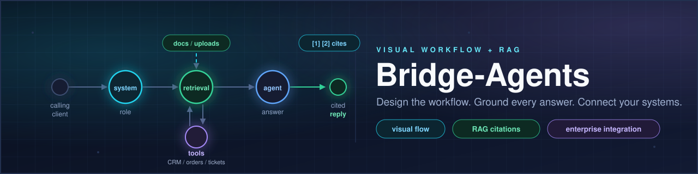
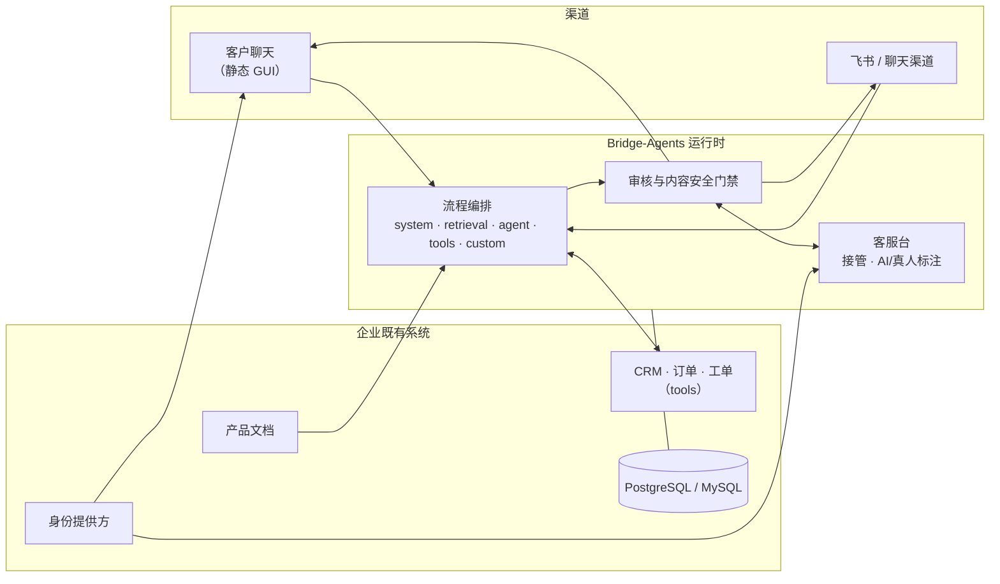
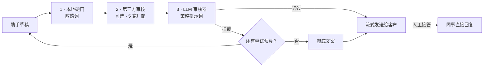

<div align="center">



# Bridge-Agents

**AI 客服对话的控制平面。**

<sub>运营人员编排流程，运行时在客户看到之前审核每一条回复，<br />企业既有系统始终是事实的来源。</sub>


<sub>简体中文 · <a href="README.md">English</a></sub>

<br /><br />

[设计总览](#设计总览) · [架构](#架构) · [自定义流程](#支柱一--运营人员自定义流程) · [输出审核](#支柱二--每条回复都经过审核) · [企业集成](#支柱三--对接企业既有系统) · [快速开始](#快速开始) · [配置与部署](#配置与部署) · [常见问题](#常见问题) · [路线图](#当前状态与路线图)

</div>

## 为什么需要 Bridge-Agents

企业缺的不是 AI 模型，而是一个能**把 AI 安全地放进客户对话**、并让三类人协同工作的地方：

- **运营人员**需要在不提软件工单的前提下，调整助手的路由、知识、语气和转人工策略；
- **审核负责人与客服主管**需要确认"客户看到的每一句话都经过检查"，并且能随时接管；
- **IT 与平台团队**希望 AI 与已有的身份系统、CRM、订单、工单、文档系统**并存**，而不是替换它们。

Bridge-Agents 正是围绕这三件事设计的。下面的 README 逐条解释这三个设计支柱及其实现方式。

## 设计总览

| 🧩 **运营自定义** | 🛡 **运行时审核** | 🔌 **集成而非替换** |
|---|---|---|
| 对话流程是保存的配置，不是代码。业务人员可在可视化画布上改流程；无法编译的流程在生效前被拒绝。模型、提示词、知识与审核设置都是 Studio 里的表单，保存后下一条消息生效。 | 每一条客户可见回复都经过分层检查：本地硬门、可选第三方审核、LLM 审核器、人工接管。文本在门禁做出判断前被缓冲；被拒绝的草稿替换为安全兜底，绝不流出。 | 身份来自企业 IdP，答案来自企业文档，动作通过企业系统 API，数据进入企业数据库，GUI 是放在企业 nginx 后的静态文件。自托管、默认 SQLite、无厂商锁定。 |

## 架构



产品刻意拆成四个平面：

- **控制平面** — 可编辑的流程图、提示词、模型与审核配置，归运营所有；保存前校验，保存后热切换进运行时。
- **数据平面** — 检索、模型调用、工具执行与渠道投递（[`packages/bridge_agents`](packages/bridge_agents)）。
- **安全平面** — review 节点、敏感词、第三方审核与人工接管，在客户看到回复之前生效。
- **集成平面** — 身份、工具、知识库、数据库与静态 GUI 部署，让产品嵌进企业现有栈。

## 支柱一 — 运营人员自定义流程

核心出发点是：**流程是配置，不是一次发布**。运营在 Studio（`/admin/studio`）里工作，而不是在代码库里。

### 流程是经过校验的图

一次对话是一张节点图；画布编辑的 JSON 配置，就是运行时编译的那一份。

| 节点 | 运营用它来做什么 |
|---|---|
| `system` | 设置助手角色提示词 |
| `retrieval` | 用知识库支撑回答（Top-K、分数阈值） |
| `agent` | 生成面向客户的回复 |
| `tools` | 让助手调用已注册的系统工具 |
| `custom` | 增加一次模型步骤（翻译、分类、改写） |
| `sanitize` | 屏蔽敏感词，可选调用第三方审核 |
| `review` | 门禁：通过、重试、兜底或放行 |
| `start` / `end` | 入口与出口 |

运营从节点面板添加节点、连线（含 `respond`、`tool_call`、`pass`、`block` 等条件句柄），拖动或自动布局，在通俗的表单里填写字段；高级用户还可以直接编辑同一份配置的 JSON。

**通过构造保证安全：** 图在保存前会被编译校验。引用不存在的节点、缺少 agent 角色、路由不通的边都会被拒绝，旧流程继续运行；保存后新图热切换，无需重新部署或重启。

### Studio 覆盖运营的其余工作

- **知识** — 上传文档、重建索引、搜索预览；也可以把 `DOCS_DIR` 指向已有的文档目录。
- **模型** — 选择厂商预设（OpenAI、Azure OpenAI 等 15 个）与 Endpoint；填写 API Key 后自动从服务商获取可用模型并以下拉框选择（Azure 列出部署）。预设地址已按厂商官方文档核对，见 [docs/providers.md](docs/providers.md)。API Key 加密存储，接口不回显。
- **客服提示词** — 在同一个地方编辑助手系统提示词。
- **内容安全** — 在 sanitize 节点启用第三方审核，选择厂商、兜底文案与 fail-open / fail-closed 策略。
- **角色与语言** — 客服与管理员可编辑，客户只能对话；界面中英双语、明暗主题、移动端自适应。

### 目前仍需开发者的部分

新的**系统能力**——接入一个新的 CRM、增加自定义节点类型、增加新渠道——目前是 Python 扩展，注册后由运营在流程里绑定和配置。把这些集成做成声明式（OpenAPI/HTTP 工具定义、插件式节点）已列入路线图，让更多集成工作从 IT 转移到运营。

## 支柱二 — 每条回复都经过审核

"审核"不是提示词里的一句话，而是运行时里一个有明确契约、缓冲与失败策略的阶段。



### 分层控制

| 层级 | 机制 | 行为 |
|---|---|---|
| 本地硬门 | `sanitize` 对所有消息做敏感词打码 | 确定性、免费、始终生效；不会因外部故障失效 |
| 第三方审核 | OpenAI 兼容、Azure AI Content Safety、Google Perspective、阿里云、腾讯云 | 可选；按节点配置 fail-open 或 fail-closed；长回复按厂商上限分片并聚合结果 |
| LLM 审核器 | `review` 节点按策略提示词判断最新草稿 | 通过、有限重试、安全兜底或放行；审核器的推理过程不会发给客户 |
| 人工接管 | 客服台"接管" | 取消待发送的 AI 回复，真人直接回复；记录中区分 AI 与真人消息 |

以上全部可在 Studio 配置：审核提示词、重试次数、兜底文案、敏感词、审核厂商、阈值与失败策略。默认值是安全的：被拒绝的草稿会被替换而不是静默丢弃，重试次数有上限。

### 设计上已经保证的，与尚未完成的

- **已保证：** 门禁节点活跃期间流式输出被缓冲，被拒绝的草稿不会先发给客户；审核器输出与厂商密钥不会暴露给客户；每条存储的消息记录来源（客户 / AI / 真人）；第三方审核故障时按配置策略继续运行。
- **尚未完成：** 不可篡改的审计日志/导出、带审批与一键回滚的流程版本历史、审核决策看板。消息存储与来源标注是基础，审计/审批工作流是下一步。

## 支柱三 — 对接企业既有系统

Bridge-Agents 是企业已有系统**旁边的一层**，而不是替代品。

| 集成面 | 连接方式 | 状态 |
|---|---|---|
| 身份 | 复用企业 IdP：HS256（本地）、RS256 PEM 或外部 OIDC JWKS；三种角色（客户、客服、管理员） | 已支持；浏览器 OIDC 登录流程下一步 |
| 知识 | `DOCS_DIR` 指向现有文档目录，或在 Studio 上传；离线 hash 嵌入或任意 `/v1/embeddings` | 已支持 |
| 系统 API | `tools` 节点绑定已注册工具；工具结果进入对话与模型上下文 | Python 注册工具已支持；声明式 HTTP/OpenAPI 工具下一步 |
| 渠道 | 同源 Web 聊天（静态 GUI 放在企业 nginx 后）与签名飞书渠道、双向真人回复 | 已支持；Slack 与通用 Webhook 下一步 |
| 存储 | 默认 SQLite；可选 PostgreSQL / MySQL；上传文件落盘或挂载卷 | 已支持 |
| 部署 | pip/uv 包（`bridge-agents`、`bridge-agents-server`）、systemd、nginx 反代、Docker Compose；GUI 为静态产物 | 已支持 |
| API 契约 | `/api/v1` 与 `/ws` 的 REST + WebSocket；`/api/v1/meta` 版本握手；`/health` | 已支持 |
| 配置 | TOML + 环境变量，标准优先级；密钥只放环境变量或加密的运行时设置 | 已支持 |
| 扩展性 | Token 校验器、聊天模型（OpenAI 兼容）、审核适配器、渠道等协议；`create_app()` 与 `AgentRuntime` | 已支持 |

### 非侵入式集成

- **企业系统仍是事实来源。** 运行时通过工具读取，除非运营配置的工具明确写入，否则不会改动企业数据；只读连接是推荐的起点。
- **演示/离线模式数据不出内网。** 默认模型、嵌入器和渠道都在本地运行，外部厂商按需开启。
- **不需要新增网关。** 把静态 GUI 部署进现有 nginx，将 `/api`、`/ws` 反代到私有端口上的 Python 服务即可；同源，无需 CORS。
- **版本兼容是显式的。** 前端读取 `/api/v1/meta`，只要满足 `min_web_version`，GUI 与服务端可以独立发版。
- **密钥默认不进入 UI 和数据库。** 密钥存放在环境变量；通过 Studio → 设置保存时加密存储。

## 一个故事，三个支柱

1. 运营打开 Studio，加入 `tools` 节点让助手能查询订单状态，把 `review` 节点移到新步骤之后并保存。流程图通过校验并热切换，无需发布。*（自定义）*
2. 客户提问。检索找到政策段落，助手生成带引用的回答，本地硬门与 LLM 审核器检查后，回答才流式发给客户。*（审核）*
3. 客户要求政策外的退款保证。审核器拦截草稿，发送配置好的兜底文案；记录留下过程；同事接管后 AI 停止。*（审核 + 人工控制）*
4. 订单查询本身是对既有订单系统的调用；身份来自公司 IdP；会话存入公司数据库；GUI 由公司 nginx 提供。*（集成）*

## 快速开始

### 一条命令（本地，无需 Docker）

需要 Python 3.11、[uv](https://github.com/astral-sh/uv)，首次构建前端需要 Node.js。

```bash
git clone <repository-url> bridge-agents
cd bridge-agents
uv sync
uv run bridge-agents demo
```

首次运行会生成 `.env`、构建前端，并启动确定性 mock 模型与 API。一个进程同时提供：

- **http://localhost:8000/** —— 客户聊天
- **http://localhost:8000/admin** —— 客服台；Studio 在 `/admin/studio`
- **http://localhost:8000/health** —— 健康检查

`bridge-agents demo --port 18000 --mock-port 8002`、`--no-build`、`make demo`、`make help` 与 `bridge-agents doctor` 覆盖常见变体。

### 一条命令（Docker）

```bash
docker compose up --build
```

客户界面 **http://localhost/**，员工入口 **http://localhost/admin**，API 健康检查 **http://localhost:8000/health**。整套离线运行，会话保存在命名卷。

### 手动开发

```bash
uv sync
cp .env.example .env          # 演示登录需要 ALLOW_DEV_LOGIN=true
uv run bridge-agents init-db
uv run bridge-agents serve --reload       # API + 构建后的界面 :8000
npm --prefix web install && npm --prefix web run dev   # Vite :5173
```

## 配置与部署

配置优先级：**命令行参数 > 环境变量 > `.env` > `bridge-agents.toml` > 默认值**。`bridge-agents init` 生成起始 TOML 与只含密钥的 `.env`；`bridge-agents config check` 校验生效配置（生产不安全默认值会报错）。完整变量见 [.env.example](.env.example)、[bridge-agents.toml.example](bridge-agents.toml.example) 与 [docs/architecture.md](docs/architecture.md)。

部署时 GUI 与 Python 分离：

| 产物 | 内容 |
|---|---|
| `bridge-agents` | 核心运行时（不含服务端依赖） |
| `bridge-agents-server` | FastAPI 服务端、数据库模型、CLI；固定匹配的核心版本 |
| `bridge-agents-web-<version>.tar.gz` | 构建好的静态 GUI，供 nginx/CDN 使用（从不进 wheel） |

```bash
pip install --find-links dist "bridge-agents-server[postgres]"
bridge-agents init --config /etc/bridge-agents/bridge-agents.toml \
    --env-file /etc/bridge-agents/bridge-agents.env
bridge-agents init-db --config /etc/bridge-agents/bridge-agents.toml
bridge-agents config check --config /etc/bridge-agents/bridge-agents.toml
bridge-agents serve --config /etc/bridge-agents/bridge-agents.toml
```

复制 [deploy/bridge-agents.service](deploy/bridge-agents.service) 与 [deploy/nginx.conf](deploy/nginx.conf)，按 [deploy/README.md](deploy/README.md) 的生产清单逐项核对。`make release` 一次构建两个 wheel 与带版本号的 Web 静态包。

## 包与嵌入

两个 Python 发行包 + 一个静态 GUI：

- **`bridge-agents`** —— 审核门禁 pipeline、流程图校验、检索、鉴权校验器、审核适配器、注入防护、限流、可嵌入的 `AgentRuntime` 与测试替身。
- **`bridge-agents-server`** —— FastAPI 应用、数据库模型与 CLI；extras：`[postgres]`、`[mysql]`。
- **Web UI** —— `web/` 下的 React/Vite，以静态包发布。

```python
from bridge_agents.runtime import AgentRuntime

async with AgentRuntime(llm=my_chat_model) as runtime:
    answer = await runtime.reply("如何激活 Widget Pro？")
    async for event in runtime.stream("可以退款吗？"):
        ...
```

已有 FastAPI 服务时，也可挂载服务端：

```python
from app.main import create_app

app.mount("/bridge-agents", create_app())
```

`bridge_agents.testing` 自带确定性 `FakeChatModel` / `FakeModerator`。详见 [packages/bridge_agents/README.md](packages/bridge_agents/README.md)。

## 适合谁

| | Bridge-Agents | 常见低代码机器人平台 |
|---|---|---|
| 审核是运行时阶段而非提示词 | ✅ 带兜底与重试的缓冲门禁 | 通常生成后再审核 |
| 运营不写代码就能改流程 | ✅ 校验通过后热切换的可视化图 | 可以，但常缺少安全门禁 |
| 融入企业现有栈 | ✅ IdP、系统工具、现有文档、数据库、自有 nginx | 多为封闭 SaaS |
| 人工接管会打断 AI | ✅ 接管即取消待发送回复 | 取决于产品 |
| 自托管、可嵌入 | ✅ pip 包 + 静态 GUI + 一条命令演示 | 通常不支持 |

低代码平台适合做原型；Bridge-Agents 面向回复带有商业或法律责任的团队——"机器人说的"不是可接受的答案。

## 当前状态与路线图

**0.1.0 开发中。** 已经可用：

| 已具备 | 下一步 |
|---|---|
| 带缓冲流式、重试、兜底与接管的审核门禁 | 不可篡改审计日志、流程版本历史、审批与回滚 |
| 本地硬门 + 5 家第三方审核适配器（含失败策略与分片） | 浏览器 OIDC 登录流程（JWKS/RS256 校验已具备） |
| 可视化流程编辑器：保存前校验、节点面板、自动布局、JSON 回退 | 声明式 HTTP/OpenAPI 工具，让运营不写 Python 也能接入更多系统 |
| Studio：知识上传/重建索引、模型厂商预设、提示词编辑 | PyPI 发布、容器镜像与发布自动化 |
| 带引用的 RAG；15 个模型厂商预设（含 Azure OpenAI） | Slack 适配器、通用 Webhook API 与可嵌入组件 |
| 客服台：接管、AI/真人标注、图片记录 | 数据库迁移（Alembic）与 `db upgrade` 命令 |
| 客户演示：昵称进入、多会话记录、附件 | Kubernetes/Helm 部署选项 |
| 飞书渠道、中英双语、响应式、明暗主题 | — |
| 打包、CLI、TOML 配置、静态 GUI 发布、systemd/nginx 模板 | — |
| 326 项离线测试、91% 覆盖率、ruff 与内容清洗门禁 | — |

## 常见问题

**非程序员真的能改 AI 流程吗？**
对话行为可以：路由、提示词、知识、审核、兜底与转人工都能在 Studio 编辑，保存前校验、无需重部署即可生效。新的**集成**（接入新系统 API、增加自定义节点）目前还需要少量 Python 扩展；声明式 HTTP 工具是下一步。

**怎么保证客户看到之前 AI 不会乱说？**
`review` 节点会缓冲草稿，用策略提示词（可选再加第三方审核）检查后，才决定放行、重试或发送兜底文案；人工接管可随时叫停 AI。

**必须用某一家模型厂商吗？**
不需要。任意 OpenAI 兼容接口都可用，Azure OpenAI 有原生客户端，Studio 内置 15 个厂商预设；Anthropic 可通过兼容网关接入。

**会替换我的 CRM / 订单系统 / IdP 吗？**
不会。它通过工具调用既有系统，并复用企业的 IdP、文档、数据库与 Web 服务器；只读集成是推荐起点。

**试用需要 Docker 或 API Key 吗？**
不需要。`uv sync && uv run bridge-agents demo` 离线运行确定性 mock 模型；Docker Compose 是替代方案。

**能上生产吗？**
0.1.0 是第一个版本。运行时与部署路径可用；受监管的生产上线应等待路线图中的审计/审批、OIDC、迁移与发布工作。参见 [deploy/README.md](deploy/README.md)。

**两个入口在哪里？**
`/` 是客户聊天（无员工导航）；`/admin` 是员工入口（客服台）；`/admin/studio` 是控制平面（流程、知识、设置）。

## 安全与隐私

仓库不包含任何凭据或客户数据。演示登录在生产禁用，角色隔离，厂商密钥只存在于环境变量（或加密的运行时设置），流程变更生效前校验，审核密钥按厂商隔离，并可用白名单限制厂商 URL。漏洞报告见 [SECURITY.md](SECURITY.md)。

## 文档

- [docs/architecture.md](docs/architecture.md) —— API、运行时节点、配置、质量门禁
- [docs/design-decisions.md](docs/design-decisions.md) —— 为什么这样设计
- [deploy/README.md](deploy/README.md) —— 生产拓扑与检查清单
- [packages/bridge_agents/README.md](packages/bridge_agents/README.md) —— 库用法
- [CHANGELOG.md](CHANGELOG.md) —— 最近变更
- [docs/releasing.md](docs/releasing.md) —— 发布清单、PyPI/GHCR 发布与回滚
- [docs/providers.md](docs/providers.md) —— 已核对的模型服务地址与模型获取说明

## 许可证

Apache-2.0，见 [LICENSE](LICENSE)。

## 出处说明

Bridge-Agents 是作者为内部生产系统构建的客户对话运行时的独立、清洗后重写版本，经书面许可发布。仓库不包含任何专有代码、数据、凭据或客户信息。
