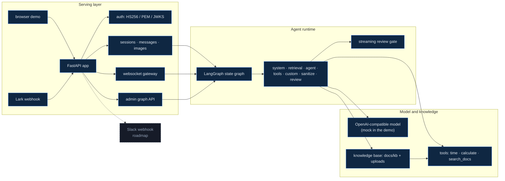
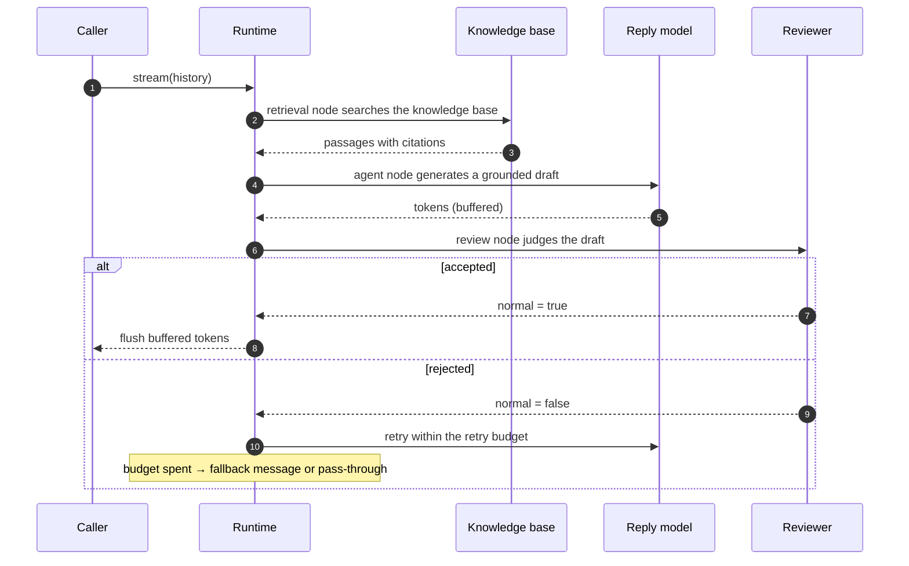

# Engineering reference

This page holds the technical detail behind the product-facing
[README](../README.md): architecture, runtime behaviour, API surface,
configuration, quality gates and design trade-offs.

> Snapshot at the time of writing (0.1.0 in progress). Numbers are reproduced
> by the commands shown next to them and are refreshed as milestones land.

## Architecture



A reviewed reply, as implemented in the runtime:



## Runtime

The graph is data: `PUT /api/v1/admin/runtime-config/agent-graph-config` validates
and compiles it before saving, then hot-swaps the runtime. Seven node kinds cover
the flow:

| Node | What it does | Notable configuration |
|---|---|---|
| `system` | Injects the agent role prompt without calling a model | `system_prompt` |
| `retrieval` | Searches the knowledge base for the last customer question and injects cited passages | `top_k`, `min_score`, `max_chars` |
| `agent` | Generates the customer-facing reply; tools bound only when the graph routes them | — |
| `tools` | Executes selected tools through a LangGraph tool node | `tools` allow-list |
| `custom` | Extra model step with its own prompt (kept out of the graph state) | `system_prompt` |
| `sanitize` | Masks configured words in every message; optionally asks an OpenAI-compatible provider to classify the latest assistant draft | `banned_words`, `replacement`, provider fields |
| `review` | Gates the reply: accept, retry, fallback or pass-through | `system_prompt`, `max_retries`, `on_block`, `fallback_message` |

The sanitize node always applies its local banned-word list as the hard gate. If
`provider_enabled` is set, it additionally classifies the latest assistant draft
(not historical messages) and replaces a flagged draft with the configured
fallback. `provider` selects one of five adapters: `openai` (any
OpenAI-compatible `/moderations`), `azure` (Azure AI Content Safety
`contentsafety/text:analyze`, severity threshold), `perspective` (Google Jigsaw
`comments:analyze`, toxicity threshold), `aliyun` (Alibaba Cloud Content
Moderation `TextModeration` 2022-03-02, HMAC-SHA1 RPC signature) and `tencent`
(Tencent Cloud TMS `TextModeration` 2020-12-29, TC3-HMAC-SHA256). Credentials
stay in the environment: `MODERATION_API_KEY` belongs to the OpenAI-compatible
adapter only, while Azure, Perspective, Alibaba Cloud and Tencent Cloud each use
their dedicated variables — one vendor's key is never sent to another. Provider
requests are split at the documented per-request text limits (600 characters for
Alibaba Cloud `TextModeration`, 10,000 for Azure and Tencent Cloud) so long
replies are classified in full; a reply that would need more than 64 requests is
treated as a provider failure (the fail-open/fail-closed policy then applies)
instead of being silently truncated.

Provider failures — network errors, unexpected payloads and missing credentials —
are turned into a moderation error and follow the configured policy: fail open
by default, or replace the draft with the fallback when `provider_fail_open` is
false. A graph that enables provider moderation is validated on save: the
endpoint must be configured and well formed, numeric ranges and provider names
are checked, and an explicitly fail-closed node is rejected while its credentials
are missing, so a misconfiguration cannot silently bypass the gate. When a
provider-backed sanitize node is reachable from a reply node, streamed text is
buffered until every gate node on the executed path (sanitize and/or review,
including parallel branches) has produced a verdict, so a blocked draft is never
streamed first. The optional `MODERATION_ALLOWED_HOSTS` allow-list limits which
hosts a graph editor can point provider requests at.

The Alibaba Cloud and Tencent Cloud signers follow the official docs:
[TextModeration 2022-03-02](https://www.alibabacloud.com/help/en/content-moderation/latest/api-green-2022-03-02-textmoderation),
[Alibaba Cloud RPC signature](https://help.aliyun.com/en/cmn/developer-reference/signature-mechanism),
[Tencent Cloud TextModeration](https://cloud.tencent.com/document/api/1124/51860) and
[Tencent Cloud TC3 signature](https://cloud.tencent.com/document/product/1278/46710).

The default graph is `system → retrieval → agent → review → end` with a `block`
edge back to the agent, so a fresh deployment demonstrates both grounding and
the gate immediately. A tool node and `agent --tool_call--> tools` edge are
added automatically when tools are enabled. Everything is covered by offline
tests with a fake model and a fake compiled graph — no network calls in CI.

Replies are produced by the reply engine. It streams agent updates, throttles
broadcasts to one every 80 ms, persists the final reply through a single
handler and always emits `stream_end` — including for empty replies, model
errors and cancellations — so clients can clear their typing state. While
human takeover is on, generation is skipped; cancelling a reply cancels the
in-flight task so a late AI answer cannot arrive after a human has replied.
The websocket gateway authenticates with `?token=`, limits each user to 100
frames per minute, accepts 4000-character messages and image uploads limited
by MIME type and `MAX_IMAGE_SIZE`.

## Human replies

A human reply is a normal agent message, not a special path:

* staff websockets can join any conversation; a staff message is stored with
  `sender_type=AGENT` with `sender_kind=ai` (human replies use `sender_kind=human`)
and broadcast to every client in the session, and it does
  not trigger the AI (only customer messages do);
* the support desk keeps a staff websocket open for the selected conversation,
  so customer messages appear live while the page is open;
* the Lark bridge reuses the same persistence helper: after `/takeover`, plain
  text in the bound chat becomes a customer-visible agent message;
* customer, assistant and support messages are mirrored to the bound Lark chat
  as best effort, in a background task that can never block a conversation.

Takeover remains the recommended order: it cancels the in-flight AI reply, so a
human answer cannot race a late model answer.

## Flow editor

The Flow tab is a React Flow canvas over the same JSON graph the runtime executes:

* the palette adds `start`, `end`, `system`, `retrieval`, `agent`, `tools`,
  `custom`, `sanitize` and `review` nodes; start/end use the reserved
  `__start__`/`__end__` ids;
* `agent` exposes `respond` and `tool_call` source handles, `review` exposes
  `pass` and `block`; other nodes have a single source handle. A connection
  becomes `condition` + `source_handle` in the saved JSON. `pass` routes are
  rendered green and `block` routes red (handles, labels and edges);
* selecting a node opens its inspector (prompts, retrieval `top_k`/score, tool
  allow-list, sanitize words, review policy); positions are saved as `x`/`y` in
  the node config, which the runtime ignores;
* saving validates locally (one start/end, system prompt, condition rules,
  reachable end) and then the backend recompiles before activating;
* auto layout recomputes a left-to-right flow: each graph level is a column,
  sibling branches stack vertically and never wrap into extra columns; the canvas
  uses the full width of the page with the node inspector directly below it;
  `JSON` switches to the raw editor
  for advanced changes. React Flow is lazy-loaded, so the customer and support
  bundles do not pay for it.

## Runtime settings

Studio → Settings exposes the two knobs an operator usually needs:

* **Model configuration** — OpenAI-compatible base URL, model name, temperature,
  timeout, retries, thinking flag and an optional API key. Values are persisted in
  the `settings` table and layered on top of the environment defaults; saving
  rebuilds the pipeline so the next message uses the new model. The API key is
  encrypted with Fernet using a key derived from `JWT_SECRET`, is never returned
  by the API and is removed when the override is reset.
* **Support prompt** — the prompt is the graph's `system` node, so the editor and
  the Flow JSON cannot drift apart. Saving rewrites the system node, recompiles
  the graph and activates it.

Both endpoints require a staff token (same tier as graph editing). In a stricter
deployment the model endpoint could be restricted to `ADMIN`; the design note in
[design-decisions.md](design-decisions.md) records the trade-off.

## Retrieval (RAG)

The retrieval node and the `search_docs` tool share one knowledge base
(`bridge_agents.rag`):

* documents are markdown/text files in `KNOWLEDGE_DIR`, seeded on first start
  from `DOCS_DIR` (`docs/kb` by default) and editable through the admin API;
* each document is split by heading into citable passages with stable ids;
* the index is hybrid: 60% cosine similarity from a deterministic hashed
  embedder (or an OpenAI-compatible `/v1/embeddings` endpoint) and 40% TF-IDF
  lexical match with light stemming and stopword removal;
* a query returns the top passages; the agent receives them as a numbered
  context block and is asked to cite them as `[1]`, `[2]`;
* answers still pass through the review node, so grounding does not bypass the
  policy gate.

Passages are decisions, not a black box: the admin API returns the score, the
vector and lexical components, the citation and a preview for each hit, and
the Studio page shows the same data before a customer ever sees an answer.

## API (implemented now)

| Method | Path | Purpose |
|---|---|---|
| GET | `/health` | Liveness only; deliberately does not touch the database |
| GET | `/` | Service name, version and docs link |
| POST | `/api/v1/auth/verify` | Validate a provider token and return the local identity |
| GET | `/api/v1/auth/me` | `{id, role, email}` for the current bearer token |
| POST | `/api/v1/auth/dev-login?role=user\|agent\|admin` | Demo-only local token (non-production) |
| GET | `/api/v1/sessions` | List the caller's conversations with unread counts |
| POST | `/api/v1/sessions` | Open a conversation |
| GET | `/api/v1/sessions/{session_id}` | Conversation detail |
| PUT | `/api/v1/sessions/{session_id}` | Rename a conversation |
| DELETE | `/api/v1/sessions/{session_id}` | Close a conversation |
| POST | `/api/v1/sessions/{session_id}/read` | Mark the conversation as read |
| GET | `/api/v1/sessions/{session_id}/messages` | Cursor-paginated message history |
| POST | `/api/v1/sessions/{session_id}/messages` | Send a message (customer messages trigger the AI) |
| POST | `/api/v1/sessions/{session_id}/images` | Upload and broadcast an image |
| GET | `/api/v1/sessions/{session_id}/images/{image_id}` | Download an image |
| WS | `/ws/v1/chat?token=<jwt>` | Join conversations, send messages/images and receive streamed replies |
| GET | `/api/v1/admin/runtime-config/agent-tools` | Tools a graph node can bind |
| GET | `/api/v1/admin/runtime-config/agent-graph` | Current graph as Mermaid source |
| GET | `/api/v1/admin/runtime-config/agent-graph-config` | Editable graph JSON |
| PUT | `/api/v1/admin/runtime-config/agent-graph-config` | Validate, persist and activate a graph |
| DELETE | `/api/v1/admin/runtime-config/agent-graph-config` | Drop the saved graph and restore the default |
| GET | `/api/v1/admin/runtime-config/model-config` | Effective model configuration (API key never returned) |
| PUT | `/api/v1/admin/runtime-config/model-config` | Persist a model override and hot-swap the pipeline |
| DELETE | `/api/v1/admin/runtime-config/model-config` | Drop the override and restore environment defaults |
| GET | `/api/v1/admin/runtime-config/agent-prompt` | Current support prompt and its source |
| PUT | `/api/v1/admin/runtime-config/agent-prompt` | Update the prompt, recompile and activate the graph |
| GET | `/api/v1/admin/sessions` | List every conversation for support |
| GET | `/api/v1/admin/sessions/{session_id}` | Conversation detail with its owner |
| GET | `/api/v1/admin/sessions/{session_id}/messages` | Transcript for support staff |
| PUT | `/api/v1/admin/sessions/{session_id}/status` | Change conversation status |
| PUT | `/api/v1/admin/sessions/{session_id}/takeover` | Enable or release human takeover |
| GET | `/api/v1/admin/users` | User directory (ADMIN only) |
| GET | `/api/v1/admin/knowledge/status` | Knowledge index statistics and document list |
| GET | `/api/v1/admin/knowledge/search` | Retrieval preview with scores and citations |
| POST | `/api/v1/admin/knowledge/reindex` | Rebuild the index from the knowledge directory |
| GET | `/api/v1/admin/knowledge/documents` | List knowledge documents |
| POST | `/api/v1/admin/knowledge/documents` | Upload or replace a markdown/text document |
| DELETE | `/api/v1/admin/knowledge/documents/{name}` | Delete a document and reindex |
| POST | `/webhook/lark` | Signed Lark event intake (disabled by default) |

Admin routes accept `AGENT` and `ADMIN` tokens; the rest of the API requires a
valid bearer token. The Lark webhook verifies request signatures, decrypts
encrypted events and runs support commands for whitelisted agents; it stays
disabled unless configured.

## Configuration

Every setting maps to an upper-case environment variable; `.env.example` is
the reference. Defaults are chosen so a fresh checkout runs without
credentials.

| Variable | Default | Purpose |
|---|---|---|
| `APP_ENV` | `development` | `production` disables the demo login |
| `DEBUG` | `false` | Enables `/docs` and `/redoc` |
| `ALLOWED_HOSTS` | `*` in code, `localhost,127.0.0.1` in the example | Trusted host middleware |
| `CORS_ORIGINS` | empty | Comma-separated browser origins |
| `DATABASE_URL` | `sqlite+aiosqlite:///./data/bridge-agents.db` | Any SQLAlchemy async URL |
| `STORAGE_DIR` | `./data/uploads` | Uploaded image storage |
| `AUTH_VERIFIER` | `hs256` | `hs256`, `rs256_pem` or `jwks` |
| `JWT_SECRET` / `JWT_ISSUER` / `JWT_AUDIENCE` | placeholder / `bridge-agents` / empty | Local token signing and verification |
| `JWT_EXPIRES_MINUTES` | `1440` | Token lifetime |
| `RS256_PUBLIC_KEY_PATH` / `JWKS_URL` | empty | Used by the matching verifier |
| `ALLOW_DEV_LOGIN` | `false` | Demo login; never mounted in production |
| `LLM_MODE` | `mock` | `mock` keeps the demo reproducible |
| `LLM_PROVIDER` | `openai` | Vendor preset: openai / azure / deepseek / qwen / moonshot / zhipu / volcengine / baidu / minimax / siliconflow / openrouter / gemini / anthropic / ollama / custom |
| `OPENAI_API_VERSION` | `2024-10-21` | Azure OpenAI API version (ignored by OpenAI-compatible providers) |
| `OPENAI_BASE_URL` / `OPENAI_MODEL` / `OPENAI_API_KEY` | mock endpoint / `mock-model` / `not-needed` | Any OpenAI-compatible endpoint |
| `OPENAI_THINKING_ENABLED` | `false` | Compatibility switch for providers with a thinking flag |
| `AGENT_TOOLS_ENABLED` / `AGENT_TOOLS` | `false` / `[]` in code, enabled in the example | Binding still requires a tool route in the graph |
| `AGENT_INJECTION_PATTERNS` | empty | Empty uses the built-in guard |
| `WS_MAX_CONNECTIONS` | `10000` | Maximum concurrent websocket connections |
| `KNOWLEDGE_DIR` / `DOCS_DIR` | `./data/knowledge` / `docs/kb` | Knowledge base storage and seed directory |
| `RAG_ENABLED` | `true` | Turns retrieval off for graphs that do not need it |
| `RAG_EMBEDDER` | `hash` | `hash` (offline, deterministic) or `openai` (`/v1/embeddings`) |
| `RAG_EMBEDDING_MODEL` | `text-embedding-3-small` | Model name sent to the embeddings endpoint |
| `RAG_TOP_K` / `RAG_MIN_SCORE` | `4` / `0.12` | Passages per query and the score threshold |
| `RAG_CHUNK_SIZE` / `RAG_CHUNK_OVERLAP` | `900` / `120` | Passage size and overlap |
| `RAG_MAX_CONTEXT_CHARS` | `2400` | Hard budget for the injected context block |
| `MODERATION_PROVIDER` | `openai` | Default adapter when a node does not set one |
| `MODERATION_BASE_URL` | empty (falls back to `OPENAI_BASE_URL`) | OpenAI-compatible endpoint base URL |
| `MODERATION_API_KEY` | empty (falls back to the model key) | Token for the OpenAI-compatible adapter |
| `MODERATION_MODEL` | `omni-moderation-latest` | OpenAI-compatible moderation model |
| `MODERATION_TIMEOUT` | `5` | Provider request timeout in seconds (0.5–30; out-of-range values are clamped) |
| `MODERATION_AZURE_ENDPOINT` / `MODERATION_AZURE_KEY` | empty | Azure AI Content Safety resource root and key |
| `MODERATION_AZURE_API_VERSION` / `MODERATION_AZURE_SEVERITY` | `2024-09-01` / `2` | Azure API version and severity threshold (1–7; 0 would flag every reply) |
| `MODERATION_PERSPECTIVE_KEY` / `MODERATION_PERSPECTIVE_THRESHOLD` | empty / `0.7` | Perspective API key and toxicity threshold (0.01–1) |
| `MODERATION_ALLOWED_HOSTS` | empty | Optional comma-separated host allow-list for provider URLs; empty allows any host |
| `MODERATION_ALIYUN_ACCESS_KEY_ID` / `MODERATION_ALIYUN_ACCESS_KEY_SECRET` | empty | Alibaba Cloud RAM AccessKey pair |
| `MODERATION_ALIYUN_REGION` / `MODERATION_ALIYUN_ENDPOINT` | `cn-shanghai` / empty | Alibaba Cloud region and optional endpoint override |
| `MODERATION_ALIYUN_SERVICE` | `comment_detection` | Alibaba Cloud moderation scene |
| `MODERATION_TENCENT_SECRET_ID` / `MODERATION_TENCENT_SECRET_KEY` | empty | Tencent Cloud API secret pair |
| `MODERATION_TENCENT_REGION` / `MODERATION_TENCENT_ENDPOINT` | `ap-guangzhou` / empty | Tencent Cloud region and optional endpoint override |
| `MODERATION_TENCENT_BIZ_TYPE` | empty | Optional Tencent Cloud review policy id |
| `LARK_ENABLED` / `LARK_APP_ID` / `LARK_APP_SECRET` | `false` / empty | Enable the Lark channel |
| `LARK_ENCRYPT_KEY` / `LARK_VERIFICATION_TOKEN` | empty | Event decryption and verification token |
| `LARK_AGENT_OPEN_IDS` | empty | Open ids allowed to run support commands |
| `LARK_COMMANDS` | `/takeover,/release,/status,/help` | Commands enabled in Lark chats |
| `LARK_API_BASE_URL` | `https://open.feishu.cn` | Lark API base; overridable for a local mock |
| `LOG_LEVEL` | `INFO` | stdout logging only |

## Lark channel

The Lark adapter (`app/services/channels/lark.py`) is disabled by default: with
`LARK_ENABLED=false` the webhook returns 404 and no outbound request is made.
When enabled it:

* verifies `X-Lark-Signature` as `sha256(timestamp + nonce + encrypt_key + raw body)`;
* decrypts `{"encrypt": ...}` events with AES-256-CBC (`SHA256(LARK_ENCRYPT_KEY)`,
  16-byte IV prefix, PKCS7 padding) — tests include Lark's published vector;
* accepts text messages from open ids listed in `LARK_AGENT_OPEN_IDS`;
* runs `/takeover`, `/release`, `/status` and `/help` (Chinese aliases included),
  binding a chat to a session on the first `/takeover <session-id>`;
* after takeover, delivers plain-text agent replies to the customer and acks the
  delivery (unknown slash commands still get help);
* mirrors customer, assistant and support messages into the bound chat, so the
  agent can follow the conversation without opening the web UI;
* replies through the tenant access token API.

`LARK_COMMANDS` restricts which commands are enabled. Tests inject a mocked
HTTP transport, so CI never contacts a real Lark endpoint.

## Library package

`packages/bridge_agents/` builds a separate distribution (`bridge-agents`,
import `bridge_agents`) with the reusable runtime:

| Module | Contents |
|---|---|
| `bridge_agents.agent` | LangGraph pipeline, node builders, graph validation, default graph |
| `bridge_agents.auth` | HS256 / RS256-PEM / JWKS verifiers, roles and identities |
| `bridge_agents.guard` | prompt-injection guard |
| `bridge_agents.rate_limit` | proxy-aware client address and fixed-window limiter |
| `bridge_agents.rag` | chunking, deterministic and OpenAI embedders, hybrid index, knowledge base |
| `bridge_agents.config` / `.errors` | settings and typed failures |

The server imports the library through thin compatibility modules, so both use
one implementation. The FastAPI app, persistence models, web UI and Lark
adapter are intentionally not part of the wheel.

```bash
uv sync
uv build --package bridge-agents
python -m venv /tmp/ba && /tmp/ba/bin/pip install dist/bridge_agents-0.1.0-py3-none-any.whl
```

## Web demo

`web/` is a small React 19 + TypeScript single-page app built with Vite 6,
**Tailwind CSS 4 and shadcn/ui components on Radix primitives** (Button, Card,
Input, Textarea, Label, Badge, Tabs), **React Flow (`@xyflow/react`) for the flow
editor**; icons come from lucide-react. It has two separate entry points sharing
one bundle:

| Path | Entry | Purpose |
|---|---|---|
| `/` | Customer | Chat only: streaming replies, review-gate fallback, image upload, reconnect indicator; the shell has no staff navigation |
| `/admin` | Staff | Support desk: live transcript over a staff websocket, takeover/release, a reply box that delivers to the customer, and close |
| `/admin/studio` | Staff | Studio: edit the conversation flow on a drag-and-drop canvas (or JSON), save (compile-checked) or reset, manage the knowledge base, and configure the runtime model and support prompt |
| `/graph` | — | Legacy URL, redirects to `/admin/studio` |
| any | — | EN / 中文 switch in the top bar; the choice is stored per browser |

The split is a UI/entry-point boundary, not an authentication boundary: the
staff APIs stay protected by the bearer token and the `AGENT`/`ADMIN` role, so
hiding navigation is defence in depth rather than the only control.

The visual system is one token set with light and dark variants (`data-theme` on
`<html>`): neutral surfaces, a single accent, pill controls, restrained shadows
and self-hosted variable fonts — Kumbh Sans for Latin UI text, Noto Sans SC for
Chinese and Roboto Mono for code. Tokens live in `web/src/index.css`
(`@theme inline`, `:root` and `.dark`), the shadcn primitives live in
`web/src/components/ui/`, and pages compose them with Tailwind utilities.
`theme.tsx` toggles the `.dark` class, persists the choice, follows
`prefers-color-scheme` on first visit, and an inline script in `index.html`
applies it before the first paint to avoid a flash.

The layout is responsive without a second app: breakpoints at 900, 640 and 380 px
stack the navigation, turn every grid into one column, hide secondary table
columns, switch the composer to a full-width row, respect safe-area insets and
keep form text at 16 px so iOS does not zoom on focus. Tested at 390x844,
360x740 and 844x390 (landscape) with no horizontal overflow.

Nginx serves the app in the demo stack and proxies `/api`, `/ws` and `/webhook`
to the API, so the browser is same-origin. Locally the Vite dev server proxies
those paths to `127.0.0.1:8000` (`cd web && npm install && npm run dev`).
The UI is bilingual: `web/src/i18n.tsx` holds the English and Chinese dictionaries,
`LanguageProvider` persists the choice in `localStorage`, detects the browser
language on first visit and localizes known system messages (takeover/release).

Front-end budget: 40 files (excluding the lockfile) and 4,968 lines including
deployment assets; the hard limit is 400 lines per file, which every component
and page respects. The flow editor is the recent addition.

## One-command demo stack

`docker compose up --build` starts the API, the web demo and a deterministic mock model:

| Service | Build | Port | Notes |
|---|---|---|---|
| `api` | root `Dockerfile` | `8000:8000` (`API_PORT` overrides) | demo login enabled; SQLite on the `bridge_agents_data` volume |
| `mock-llm` | `mock/Dockerfile` | internal `8001` | deterministic OpenAI-compatible model, no outbound calls |
| `web` | `web/Dockerfile` | `80:80` (`WEB_PORT` overrides) | React demo served by nginx, proxying `/api`, `/ws` and `/webhook` |
| `mysql` | `mysql:8.3` | internal `3306` | optional profile: `docker compose --profile mysql up` |

The runtime points at `http://mock-llm:8001/v1`, so a fresh clone needs no API
key. The mock covers the normal reply, the refund promise that the review gate
rejects, the `[[tool]]` tool-call round trip, knowledge-grounded replies and the
reviewer verdict; its protocol — including a deterministic `/v1/embeddings`
endpoint — is documented in [mock/README.md](../mock/README.md). The knowledge
base is seeded into `/data/knowledge` on first start, so uploads survive a
restart too. Conversations, images and knowledge documents live on the named
volume and survive `docker compose restart api`. Open `http://localhost` for the
web demo and `http://localhost:8000/health` for the API.

## Quality gates

```bash
uv run pytest -q                                                            # 241 passed
uv run pytest --cov=app/core --cov=bridge_agents --cov-report=term-missing --cov-fail-under=70  # 91%
uv run ruff check .                                                         # clean
uv run ruff format --check .                                                # clean
uv run python scripts/check_sanitized.py                                    # exit 0
```

Current snapshot: **290 tests** collected, **91%** combined line coverage of
`app/core` and the extracted `bridge_agents` library (build gate: 70%), ruff
clean, and the repository sanitisation gate passes. The tree today is 4,188
lines of application Python, a 2,765-line library, 4,317 lines of tests and a
2,061-line web demo.

## Design decisions

| Decision | Why | Cost |
|---|---|---|
| Buffer streamed tokens while a review exists | A rejected draft can never flash on screen | Higher first-token latency when the gate is present |
| Compile the graph before saving it | Route mistakes fail at save time, not in production | Saving does real work; broken configs are rejected exactly because of it |
| Bind tools only when the graph routes tool calls | The model cannot emit a call that no node executes | The graph must declare the route explicitly |
| Write a role once, on first login | Later token claims cannot silently change privileges | Role changes require an explicit admin action (roadmap) |
| Mock model mode by default | The demo is deterministic and needs no API key | The mock must be kept in sync with the runtime contract (tests enforce it) |
| Retrieval is a graph node, not hidden middleware | Operators can see, move or remove grounding per flow | The graph must route into the retrieval node |
| Hybrid retrieval with a deterministic default embedder | Offline demo, exact-token matches and no model download | A real deployment should switch to an embeddings endpoint |
| Human replies reuse the message pipeline | One persistence/broadcast path for AI, web staff and Lark | The UI must enforce takeover before replying (the API does not cap it) |

## Repository layout

```
app/
  core/agent/   LangGraph runtime, node builders, review gate, prompts, tools, injection guard
  core/         token verifiers, exception envelope, logging, helpers
  api/          auth, sessions, messages, images, admin support desk and graph routes
  models/       async SQLAlchemy models and schema bootstrap
  schemas/      request/response models
  services/     sessions, messages, images, reply engine/handler, runtime config, takeover
  services/channels/  channel abstraction and the Lark adapter
  ws/           websocket gateway (subscriptions, streaming, rate limiting)
  main.py       application factory and lifespan wiring
packages/bridge_agents/  standalone core library (agent runtime, auth, guard, rate limit)
tests/          290 offline tests (fake model, fake compiled graph, mock Lark transport)
docs/kb/        fictional product documentation used by the search tool
docs/assets/    documentation artwork
scripts/        init_db.py, check_sanitized.py, allowlist
Dockerfile      api image (non-root, healthcheck)
docker-compose.yml  api + mock-llm + web (+ optional mysql profile)
mock/           deterministic OpenAI-compatible mock model
web/            React demo (chat, flow editor, support desk) served by nginx
```

## Sanitisation gate

This repository is an independent rewrite. `scripts/check_sanitized.py` scans
every tracked file and the commit history for forbidden content, and checks
for committed environment files, key material and absolute paths. Real
credential values never live in the repository: they are read from a
git-ignored local file or injected by CI, and the gate is covered by its own
negative test (an injected probe fails the build).
